# CIRCLEUP — MASTER SYSTEM DESIGN DOCUMENT (SDD)

**Version:** 1.0 (Engineering Blueprint)  
**Target Stack:** React + TypeScript (Vite) · Node.js + Express + TypeScript · MongoDB Atlas (Mongoose) · Cloudinary · Vercel + Render  
**Architecture Style:** Modular Monolith with Shared Domain Contracts & Three Decoupled Frontend Portals  
**Status:** Pre-Implementation Architectural Blueprint (Zero Application Code Written)

---

## Table of Contents

1. [System Overview & Core Boundaries](#1-system-overview--core-boundaries)
2. [Architecture Decisions & Justifications (ADRs)](#2-architecture-decisions--justifications-adrs)
3. [High-Level, Low-Level & Integration Architecture](#3-high-level-low-level--integration-architecture)
4. [Frontend Architecture](#4-frontend-architecture)
5. [Backend Architecture](#5-backend-architecture)
6. [Database System Design (MongoDB & Mongoose)](#6-database-system-design-mongodb--mongoose)
7. [Authentication & Authorization Architecture](#7-authentication--authorization-architecture)
8. [Product & Inventory System](#8-product--inventory-system)
9. [Cart & WhatsApp Checkout System](#9-cart--whatsapp-checkout-system)
10. [Rental Management System](#10-rental-management-system)
11. [Order Management System](#11-order-management-system)
12. [Customer CRM Architecture](#12-customer-crm-architecture)
13. [Owner CRM Architecture](#13-owner-crm-architecture)
14. [Community System (Reviews, Events & #ThriftCrew)](#14-community-system-reviews-events--thriftcrew)
15. [Complete REST API Specification](#15-complete-rest-api-specification)
16. [Security Architecture Review & Mitigations](#16-security-architecture-review--mitigations)
17. [External Service Integrations](#17-external-service-integrations)
18. [Notification System](#18-notification-system)
19. [Deployment & DevOps Architecture](#19-deployment--devops-architecture)
20. [Testing Architecture](#20-testing-architecture)
21. [Performance & Scalability Strategy](#21-performance--scalability-strategy)
22. [Risk Assessment & Mitigations](#22-risk-assessment--mitigations)
23. [Implementation Roadmap (Milestones M0–M7)](#23-implementation-roadmap-m0m7)
24. [Consistency Review, Assumptions & Open Decisions](#24-consistency-review-assumptions--open-decisions)

---

## 1. System Overview & Core Boundaries

**CircleUp** is a centralized thrift-commerce, fashion rental, and community platform uniting three user-facing applications over a single REST API and MongoDB database:

1. **Public Customer Website:** SEO-friendly storefront for discovering Pre-Loved, Fresh Finds, Handcrafted, and Rental inventory, browsing category collections, managing carts, initiating WhatsApp checkout requests, exploring community events (*The Social Circle*), reading reviews, and viewing approved *#ThriftCrew* posts.
2. **Customer CRM (`/account/*`):** Authenticated customer portal for profile & address book management, tracking orders, monitoring active rentals & return deadlines, managing wishlists, viewing in-app notifications, submitting verified product reviews, registering for events, and uploading *#ThriftCrew* content.
3. **Owner CRM (`/admin/*`):** Role-restricted administrative control plane for business analytics (Recharts), product/variant catalog CRUD, single/multi-unit inventory tracking, WhatsApp checkout request verification & order conversion, rental booking approval/deposit/late-fee reconciliation, customer moderation, CMS editing, community moderation, and immutable audit logs.

### Core Domain Boundaries
- **Sales vs. Rentals Separation:** Purchase orders (`carts` -> `checkoutRequests` -> `orders` -> `orderItems`) and rental bookings (`rentals` -> `rentalTransactions` + `rentalDateLocks`) are completely separated modules and collections. Rentals cannot be added to ordinary purchase carts because they carry date intervals, turnaround cleaning buffers, refundable deposits, and inspection penalties.
- **Pre-Persisted WhatsApp Checkout:** Clicking "Proceed to WhatsApp" never skips persistence or fakes confirmation. Every WhatsApp enquiry is written as a `CheckoutRequest` in MongoDB with a deterministic `cartCode` first, and only transitions to a confirmed `Order` when the Owner manually verifies payment/intent inside the Owner CRM.
- **Zero-Oversell Inventory Guarantee:** Single-unit thrift items (`stock: 1`) and multi-unit fresh/handcrafted items share a unified atomic stock reservation/deduction engine backed by MongoDB conditional updates and multi-document ACID transactions.

---

## 2. Architecture Decisions & Justifications (ADRs)

### ADR-01: Language Choice — TypeScript (Frontend & Backend) vs. JavaScript
| Dimension | Decision |
| :--- | :--- |
| **Proposal** | **TypeScript (strict mode)** across the React Frontend and Node.js/Express Backend, with a shared contracts folder/package (`shared/types` & enums). |
| **Why Needed** | CircleUp manages complex domain unions (`pre_loved \| fresh_finds \| rental \| handcrafted`, `single_unit \| multi_unit`), multi-step status machines (orders, checkout requests, rentals), and three portals consuming one API. Static typing eliminates API payload drift, typo bugs in status strings, and unsafe `any` accesses on nested Mongoose snapshots. |
| **Alternatives Considered** | 1. **Plain JavaScript (ESM) everywhere:** Zero compile step, faster initial setup, but prone to runtime shape mismatches across 22 collections and 80+ endpoints.<br>2. **TypeScript on Frontend + JavaScript on Backend:** Avoids backend compilation, but sacrifices shared DTO/enum safety between Express validators and React forms. |
| **Trade-offs** | Adds `tsc` compilation (`tsx` in dev, `tsc` build for prod) and minor upfront type-authoring overhead in exchange for long-term refactoring confidence and safer team collaboration. |
| **Dependencies** | Node.js LTS (v20/v22), `typescript`, `tsx`, `@types/express`, `@types/node`, `zod` (for runtime + static type inference via `z.infer`). |

### ADR-02: Frontend State Management & HTTP Client — Redux Toolkit + TanStack Query + Axios
| Dimension | Decision |
| :--- | :--- |
| **Proposal** | **Redux Toolkit (RTK)** for synchronous client/auth/UI state + **TanStack Query (React Query)** for server data caching/invalidation + **Axios** as the HTTP transport client. |
| **Why Needed** | Context API alone causes subtree re-render storms as cart drawers, notifications, and filter state evolve, and writing manual `useEffect` fetch/loading/error logic across 3 portals invites race conditions and stale data. Axios adds interceptors for queued silent JWT refresh and upload progress tracking. |
| **Alternatives Considered** | 1. **Context API + Fetch API:** Zero extra packages, but requires rebuilding retry queues, request deduplication, caching, and pagination state from scratch.<br>2. **RTK Query (pure Redux):** Built on Fetch; lacks native Axios upload progress (`onUploadProgress`) and clean custom refresh-lock interceptors compared to Axios + TanStack Query. |
| **Trade-offs** | Adds two lightweight, industry-standard dependencies (`@tanstack/react-query`, `axios`) alongside `@reduxjs/toolkit`, dramatically shrinking boilerplate across Customer & Owner CRMs. |
| **Dependencies** | `@reduxjs/toolkit`, `react-redux`, `@tanstack/react-query`, `axios`. |

### ADR-03: Authentication Strategy — Short-Lived In-Memory JWT + Rotating HttpOnly Refresh Cookie + DB Session Store
| Dimension | Decision |
| :--- | :--- |
| **Proposal** | **Dual-token hybrid session architecture:** 15-minute JWT Access Token (10 min for Admins) stored strictly in **React/Redux memory** (sent via `Authorization: Bearer`) + 7-day (12h for Admins) opaque **Refresh Token** in an `HttpOnly`, `Secure`, `SameSite=Lax` cookie backed by an `authSessions` MongoDB collection with token rotation and reuse detection. |
| **Why Needed** | Storing JWTs in `localStorage` exposes accounts to XSS theft. Pure stateless JWTs cannot revoke compromised sessions or enforce immediate logout/suspension. Pure server-side `express-session` hits MongoDB on every read request. Hybrid dual-token gives fast stateless access verification on read endpoints while guaranteeing instant revocation on logout, password reset, suspension, or suspicious refresh reuse. |
| **Alternatives Considered** | 1. **Pure Stateless JWT in `localStorage`:** Vulnerable to XSS and impossible to revoke before expiry.<br>2. **Stateful `express-session` (`connect-mongo`):** Simpler mental model, but causes extra DB lookup per request and requires CSRF tokens on every single mutating endpoint. |
| **Trade-offs** | Requires a refresh-token rotation endpoint and a queued 401 retry interceptor in Axios; also requires first-party cookie alignment (`circleup.in` + `api.circleup.in` or Vercel API rewrite proxy) in staging/prod. |
| **Dependencies** | `jsonwebtoken`, `bcrypt`, `cookie-parser`, `crypto` (Node built-in), custom domain or Vercel rewrite proxy. |

### ADR-04: Backend Hosting — Render vs. Railway vs. VPS
| Dimension | Decision |
| :--- | :--- |
| **Proposal** | **Render (Paid Web Service + Render Cron Jobs)** as the primary production recommendation (with **Railway** as an acceptable runner-up). |
| **Why Needed** | Render provides Git-driven zero-downtime deploys, automatic TLS, fixed predictable monthly pricing (starting at USD 7/mo Starter to avoid cold-start sleep), and native **Render Cron Jobs** for rental overdue detection and unpaid reservation cleanup without managing Linux servers, Nginx, Certbot, or systemd. |
| **Alternatives Considered** | 1. **Railway:** Excellent DX and usage-based billing, slightly less predictable cost under spiky traffic or memory overhead.<br>2. **Unmanaged VPS (DigitalOcean/Hetzner):** Lowest raw compute cost, full process control, but requires a small team to own OS security patching, firewalling, reverse proxy setup, zero-downtime swap scripts, and manual log rotation. |
| **Trade-offs** | Higher cost per vCPU than raw VPS, but preserves 100% of engineering velocity for product features. Must NOT use Render's sleeping Free tier in production (sleeps after 15 mins of inactivity, breaking UX). |
| **Dependencies** | GitHub CI/CD integration, `GET /api/v1/health` readiness endpoint. |

### ADR-05: Image Upload Pipeline — Signed Direct-to-Cloudinary vs. Express Multer Proxy
| Dimension | Decision |
| :--- | :--- |
| **Proposal** | **Backend-Signed Direct-to-Cloudinary Uploads** (Frontend requests a short-lived signature from Express, uploads directly to Cloudinary over HTTPS, then submits resulting `public_id` and metadata to Express for verification and storage). |
| **Why Needed** | Proxying 5–10 high-res product or `#ThriftCrew` photos per upload through a single Node.js container on Render consumes RAM/event-loop bandwidth and risks hitting platform request timeouts/payload caps. Direct signed upload keeps heavy binary traffic off the API server while maintaining backend access control (`POST /api/v1/uploads/signature` is strictly authenticated & folder-scoped). |
| **Alternatives Considered** | **Multer (`memoryStorage`) -> Express -> Cloudinary SDK:** Simpler 1-step client call, but creates OOM (Out-of-Memory) crash risks on 512MB–1GB PaaS instances when multiple admins/customers upload simultaneously. |
| **Trade-offs** | Requires two-step client flow (fetch signature -> upload -> save resource) and a scheduled orphan cleanup check for Cloudinary assets uploaded but never attached to a saved product/post. |
| **Dependencies** | `cloudinary` Node SDK, Axios `onUploadProgress`, Cloudinary upload presets/folder rules. |

### ADR-06: Architecture Topology — Modular Monolith vs. Microservices
| Dimension | Decision |
| :--- | :--- |
| **Proposal** | **Domain-Modular Monolith** (single Express deployment organized into strictly isolated domain modules: `auth`, `catalog`, `inventory`, `cart`, `checkout`, `orders`, `rentals`, `community`, `crm`, `notifications`, `analytics`). |
| **Why Needed** | A small engineering team building a startup thrift/rental platform needs transactional integrity across inventory, orders, rentals, and audit logs (single MongoDB replica set transactions), fast local setup, and one CI/CD pipeline. Microservices would introduce distributed Saga failure modes, network latency, duplicated auth logic, and DevOps bloat with zero near-term gain. |
| **Alternatives Considered** | **Microservices (Catalog Service, Order Service, Rental Service, Auth Service):** Premature complexity; breaks ACID MongoDB transactions across inventory and orders. |
| **Trade-offs** | All domains scale together vertically/horizontally; mitigated by keeping modules decoupled via explicit service interfaces so heavy modules (e.g., analytics or image/notification workers) can be extracted later if traffic justifies it. |
| **Dependencies** | Strict lint/import boundaries between backend domain folders (`services/` communicate only via public module methods, never cross-importing internal helpers). |

### ADR-07: Inventory Reservation Timing for WhatsApp Checkout
| Dimension | Decision |
| :--- | :--- |
| **Proposal** | **Two-Phase Explicit Reservation Policy:** Persisting a `CheckoutRequest` validates live availability and snapshots prices **without** permanently locking stock (`status: INITIATED`). Stock is **atomically reserved (`RESERVED`) or deducted (`CONFIRMED`)** only when the Owner initiates payment verification or confirms the order in Owner CRM. |
| **Why Needed** | Because WhatsApp Click-to-Chat offers no send-receipt webhook, users frequently open WhatsApp and abandon the chat without sending the message. Hard-locking a unique 1-of-1 thrift garment at button-click would let idle tabs or bots freeze store inventory. Meanwhile, atomic conditional locking at Owner confirmation (`availableStock >= qty` inside a transaction) guarantees two competing enquiries can never oversell the same unique piece. |
| **Alternatives Considered** | **Immediate 15-Minute TTL Hold on WhatsApp Click:** Reduces owner rejection of competing enquiries, but in manual WhatsApp workflows owners often reply after 15–120 minutes, causing holds to silently expire anyway while hurting conversion from false "Out of Stock" errors during browsing. |
| **Trade-offs** | Two customers may simultaneously submit WhatsApp enquiries for the last item; Owner CRM solves this cleanly by displaying a **"Competing Enquiries"** badge and letting the Owner click "Confirm" on the paying buyer while auto-flagging rival enquiries for one-click rejection. |
| **Dependencies** | MongoDB Replica Set transactions, `inventoryLogs`, Owner CRM checkout queue UI. |

---

## 3. High-Level, Low-Level & Integration Architecture

### 3.1 How the System Works End-to-End
- **React Frontend <-> Express API:** All three UI portals live within a unified Vite + React TypeScript SPA (or split routes with code-splitting by portal) deployed on Vercel, communicating over HTTPS JSON REST APIs (`/api/v1/*`) via Axios. Vercel rewrite proxies (or same-site custom domain `api.circleup.in`) keep authentication cookies first-party.
- **Separation of Public, Customer CRM & Owner CRM:** Separated at three tiers: (1) Router & lazy-loaded UI bundle boundaries (`/`, `/account/*`, `/admin/*`), (2) Dedicated API namespace & auth endpoints (`/api/v1/auth/*` for customers vs. `/api/v1/admin/auth/*` for Owner/Staff), and (3) Separate collections (`users` vs. `admins`) with backend RBAC + ownership guards.
- **Backend <-> MongoDB Atlas:** Express connects at startup using a single managed Mongoose connection pool (`minPoolSize: 5`, `maxPoolSize: 20` tuned to PaaS tier) against a MongoDB Atlas Replica Set, enabling multi-document ACID transactions for orders, rentals, and inventory ledger updates.
- **Image Uploads:** Clients request a signed upload signature from Express -> upload directly to Cloudinary -> receive secure URL + `public_id` -> submit form to Express -> Express validates `public_id` prefix and persists references.
- **WhatsApp Checkout:** Client calls `POST /api/v1/checkout/requests` -> Express validates stock/prices, persists `CheckoutRequest` (`PENDING_REVIEW`), generates formatted WhatsApp message + `wa.me` URI -> Frontend redirects to WhatsApp -> Owner processes enquiry in Owner CRM -> Confirmation atomically creates `Order` + `OrderItem`s + deducts inventory.
- **Inventory, Orders & Rentals Interaction:** `InventoryService` is the sole mutator of `products.variants[].stock` / `reservedStock` and writes immutable `inventoryLogs`. `OrderService` invokes `InventoryService` inside transactions. `RentalService` is completely independent and uses `rentalDateLocks` + transactions instead of sales stock deduction.
- **Notifications:** Domain events (order confirmed, rental approved, return reminder, community approval) create persistent `notifications` records for Customer/Owner CRM in-app trays and enqueue email dispatches via `EmailService`.

### 3.2 High-Level Architecture Diagram

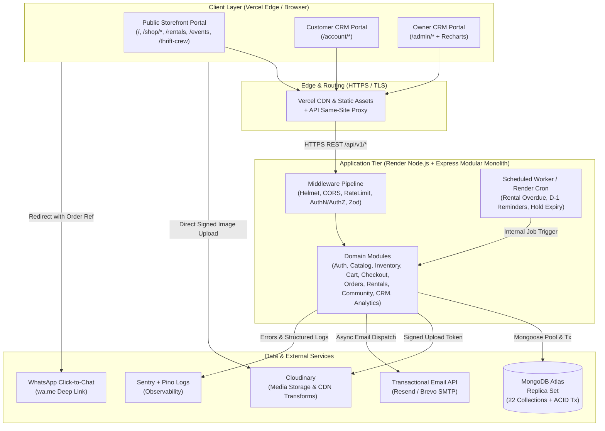

### 3.3 Low-Level Architecture Diagram (Backend Request Execution)

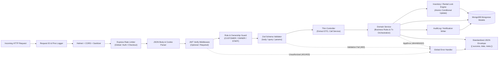

### 3.4 Component Diagram (Frontend & Shared Modules)

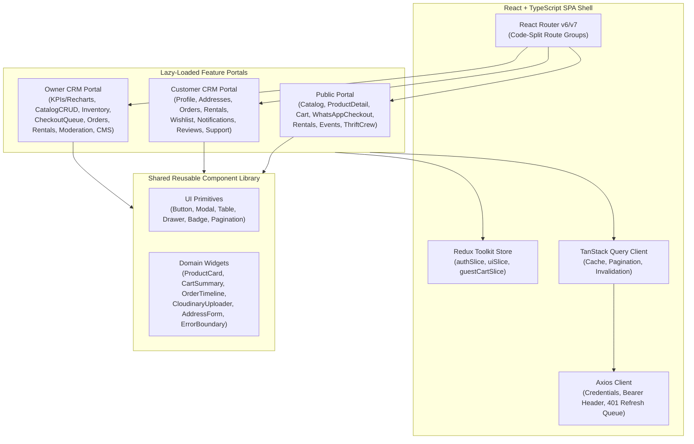

### 3.5 Deployment Architecture Diagram

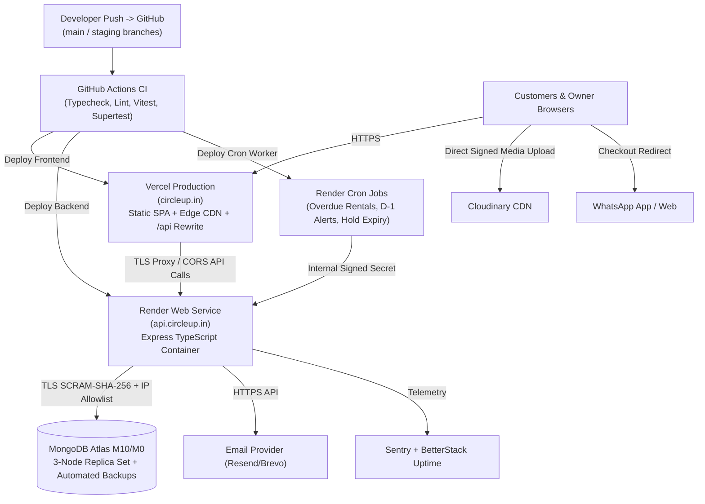

### 3.6 Request / Response Flow Diagram (End-to-End Authenticated Cart -> WhatsApp Checkout -> Order Confirmation)

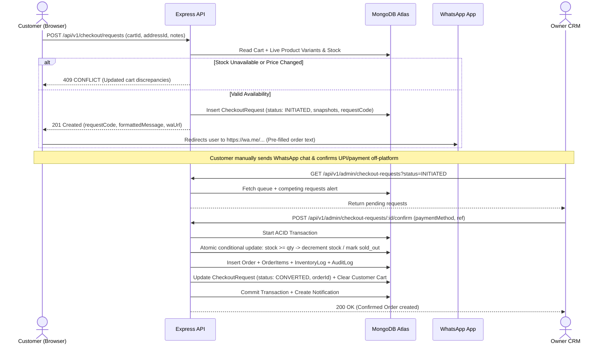

### 3.7 External Service Integration Diagram

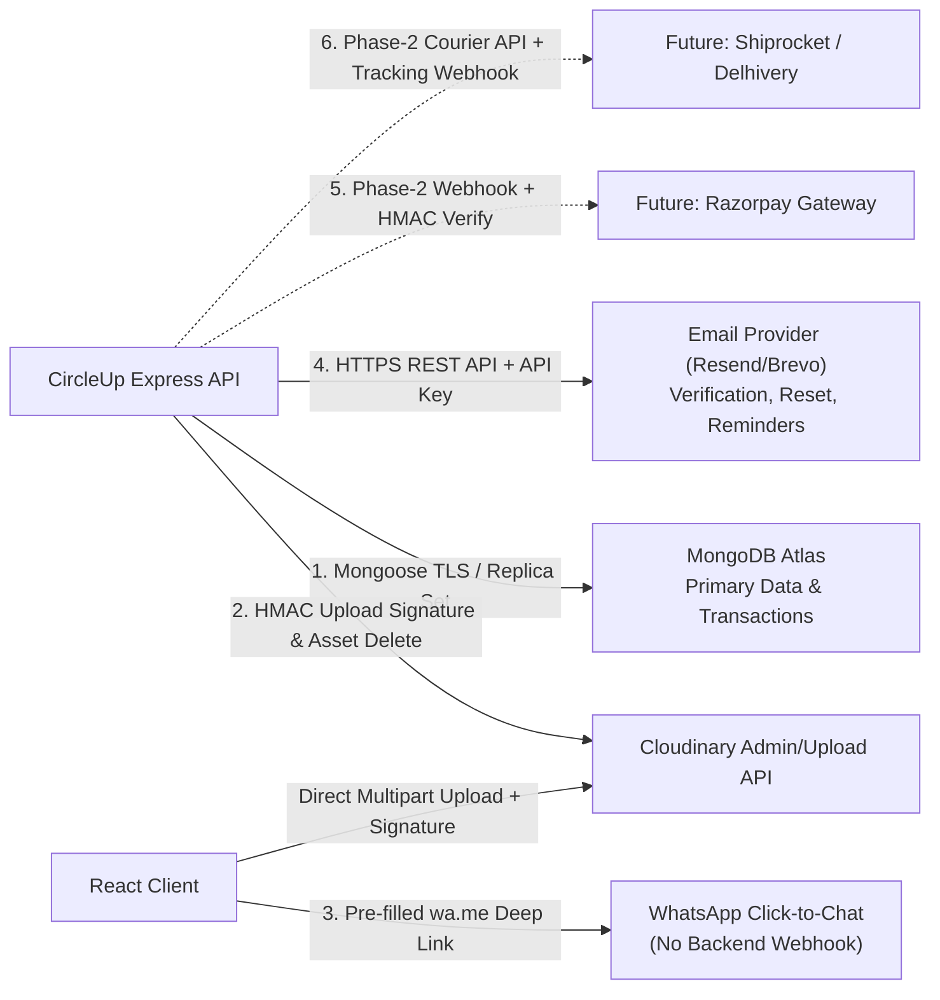

---

## 4. Frontend Architecture

### 4.1 Complete Route Architecture (3 Strict Route Groups)
All routes live inside a code-split React Router tree (`createBrowserRouter`), with separate layout wrappers (`PublicLayout`, `CustomerLayout`, `AdminLayout`).

#### A. Public Website (`PublicLayout` — Public Access)
| Path | Page Component | Purpose |
| :--- | :--- | :--- |
| `/` | `HomePage` | Hero, featured categories, New Arrivals, #ThriftCrew preview, Social Circle highlights (driven by `siteContent` + catalog queries) |
| `/new-arrivals` | `CatalogPage` (`preset="new-arrivals"`) | Latest active arrivals sorted by `createdAt desc` |
| `/shop/:categorySlug` | `CatalogPage` | Shared dynamic catalog component serving **all** category routes:<br>• `/shop/womens-upperwear`<br>• `/shop/womens-bottomwear`<br>• `/shop/womens-one-piece`<br>• `/shop/mens-upperwear`<br>• `/shop/mens-bottomwear`<br>• `/shop/footwear`<br>• `/shop/ethnic-wear`<br>• `/shop/thrifted-treasure`<br>• `/shop/jewellery`<br>• `/shop/accessories`<br>• `/shop/handcrafted` |
| `/rentals` | `RentalCatalogPage` | Rental-only catalog with start/end date filter widget |
| `/products/:slug` | `ProductDetailPage` | Supports purchase mode (variants/condition/add-to-cart) or rental booking mode (date calendar, deposit breakdown, request booking) |
| `/cart` | `CartPage` | Persistent cart review, qty adjustment (locked to 1 for single-unit), checkout initiation |
| `/checkout/whatsapp` | `WhatsAppCheckoutPage` | Address confirmation, customer notes, pre-persists `CheckoutRequest`, displays `requestCode` fallback & opens WhatsApp |
| `/about` | `CmsContentPage` (`key="about"`) | Brand story & sustainability mission from `siteContent` |
| `/contact` | `ContactPage` | Store details + enquiry/support form |
| `/reviews` | `ReviewsPage` | Aggregated verified store & product reviews |
| `/events` & `/events/:slug` | `EventsPage` / `EventDetailPage` | *The Social Circle* upcoming/past events + registration |
| `/thrift-crew` | `ThriftCrewPage` | Approved *#ThriftCrew* community gallery + submission entry |
| `/login`, `/register`, `/forgot-password`, `/reset-password/:token`, `/verify-email/:token` | Auth Pages | Customer authentication flows (`GuestOnly` guard redirects if already logged in) |

#### B. Customer CRM (`CustomerLayout` — `RequireAuth roles=['CUSTOMER']`)
| Path | Module |
| :--- | :--- |
| `/account` | Customer Dashboard & Profile Management (name, phone, avatar, password change) |
| `/account/addresses` | Saved Delivery Address Book (CRUD + set default) |
| `/account/orders` | Order History (paginated list + status filter) |
| `/account/orders/:orderId` | Order Details, Item Snapshots, Status Timeline, Tracking Info & Review trigger |
| `/account/rentals` | Rental Requests & Active Rentals (due dates, status) |
| `/account/rentals/:rentalId` | Rental Details, Security Deposit Status, Late/Damage Fee Ledger |
| `/account/wishlist` | Saved Wishlist Items (live stock/sold-out status + move-to-cart) |
| `/account/cart` | Account-scoped view of shared `CartWorkspace` |
| `/account/notifications` | In-App Notifications Inbox (mark read / mark all read) |
| `/account/reviews` | My Submitted Reviews & Eligible Unreviewed Purchases |
| `/account/community` | My Event Registrations & `#ThriftCrew` Submissions (status + consent info) |
| `/account/support` | Order-linked WhatsApp deep link & support request submission |

#### C. Owner CRM (`AdminLayout` — `RequireAdmin roles=['OWNER', 'STAFF']`)
| Path | Module |
| :--- | :--- |
| `/admin/login` | Isolated Admin Login Portal (`AdminGuestOnly`) |
| `/admin` | Executive Dashboard (KPI cards + Recharts revenue & order velocity charts) |
| `/admin/analytics` | Deep Analytics (Revenue by product type, top categories, rental utilization, bestselling SKUs) |
| `/admin/products` | Product & Variant CRUD, Cloudinary image upload, archive/publish toggles |
| `/admin/categories` | Category & Subcategory Tree Management |
| `/admin/inventory` | Live Stock Matrix, Low/Single-Unit View, Manual Adjustments & `InventoryLogs` viewer |
| `/admin/checkout-requests` | WhatsApp Checkout Request Queue (filter, inspect competing requests, Reserve/Confirm/Reject) |
| `/admin/orders` | Order Management (status transitions, shipping tracking updates, cancellations, returns/refunds) |
| `/admin/rentals` | Rental Management (availability calendar, request approval/rejection, return check-in, deposit/late-fee settlement) |
| `/admin/customers` | Customer Directory, Search, Profile + Order/Rental History, Account Active/Suspended toggle |
| `/admin/reviews` | Review Moderation & Admin Reply |
| `/admin/events` | Event CRUD & Attendee Registration Export/Check-in |
| `/admin/community` | `#ThriftCrew` Moderation Queue (verify consent, approve/reject/feature) |
| `/admin/content` | Website CMS (`siteContent`: Hero banners, Featured sections, Policies, About/Contact) |
| `/admin/notifications` | Admin Operational Alerts (new checkout requests, rental requests, overdue returns) |
| `/admin/settings` | Business Settings (WhatsApp number, default rental turnaround days, future Staff account management) |
| `/admin/audit-logs` | Immutable Admin & Security Audit Log Explorer |

### 4.2 Frontend Folder Structure & Duplication Prevention
**Anti-Duplication Rule:** Business logic (price formatting, status badge colors, WhatsApp text previews, Zod validation schemas) and UI primitives live in `src/shared/` and `src/services/`. The 11 storefront category pages are **one** parameterized `CatalogPage` driven by `categorySlug` and `categories` metadata from MongoDB—zero copy-pasted category page files. `CartView`, `OrderTimeline`, `ProductCard`, and `CloudinaryUploader` are shared across Public, Customer CRM, and Owner CRM.

```text
frontend/
├── src/
│   ├── app/
│   │   ├── router.tsx                 # Code-split routes & guards
│   │   ├── store.ts                   # Redux Toolkit store
│   │   └── queryClient.ts             # TanStack Query default config
│   ├── shared/
│   │   ├── types/                     # Shared TS interfaces matching backend DTOs
│   │   ├── constants/                 # Status enums, role maps, category slugs
│   │   ├── schemas/                   # Zod form schemas (login, address, product, rental)
│   │   ├── utils/                     # Currency formatting (INR), date/IST helpers, WhatsApp URI builder
│   │   └── components/
│   │       ├── ui/                    # Button, Input, Select, Modal, Drawer, Table, Skeleton, Toast
│   │       ├── domain/                # ProductCard, StatusBadge, CartSummary, ImageUploader, Pagination
│   │       └── guards/                # ProtectedRoute, RoleRoute, ErrorBoundary
│   ├── services/
│   │   ├── apiClient.ts               # Axios instance + 401 refresh queue interceptor
│   │   ├── auth.api.ts
│   │   ├── catalog.api.ts
│   │   ├── cart.api.ts
│   │   ├── checkout.api.ts
│   │   ├── orders.api.ts
│   │   ├── rentals.api.ts
│   │   ├── community.api.ts
│   │   └── admin.api.ts
│   ├── store/slices/
│   │   ├── authSlice.ts               # In-memory accessToken, user, actorType, isInitialized
│   │   ├── cartUiSlice.ts             # Cart drawer state, guestCartToken sync
│   │   └── uiSlice.ts                 # Global toast queue, active modals
│   ├── features/
│   │   ├── public/                    # Home, CatalogPage, ProductDetail, Checkout, Events, ThriftCrew
│   │   ├── auth/                      # Customer Login/Register/Reset & Admin Login
│   │   ├── customer-crm/              # Account pages & hooks
│   │   └── owner-crm/                 # Lazy-loaded Admin pages + Recharts widgets
│   └── main.tsx
```

### 4.3 Auth State, Protected Routes, Error Handling & Data Fetching
- **Bootstrap Hydration:** On app mount, `AuthProvider` calls `POST /api/v1/auth/refresh` (or `/api/v1/admin/auth/refresh` when on `/admin/*`, or unified `/auth/session`) using the `HttpOnly` refresh cookie to obtain a fresh in-memory `accessToken` + user profile before protected routes decide whether to redirect.
- **Axios 401 Refresh Queue:** When an API call receives `401 TOKEN_EXPIRED`, `apiClient` pauses concurrent failed requests in a promise subscriber queue, triggers a single refresh call (`isRefreshing = true`), injects the new `accessToken`, and replays queued requests seamlessly. If refresh fails, Redux clears auth state and redirects cleanly to `/login` or `/admin/login`.
- **Global Error Handling & Loading States:**
  - Route-level React `ErrorBoundary` catches rendering exceptions with fallback recovery UI.
  - Axios normalizes all backend errors to `{ code, message, fieldErrors, requestId }`.
  - React Hook Form maps `fieldErrors` directly to form inputs; transient network/server errors fire toast alerts; `TanStack Query` exposes standardized `isPending`, `isFetching`, and `isError` states paired with domain-specific skeleton loaders.

---

## 5. Backend Architecture

### 5.1 Layered Modular Monolith Responsibilities
| Layer | Folder | Responsibility | Strict Rules |
| :--- | :--- | :--- | :--- |
| **Routes** | `modules/*/routes.ts` | Map HTTP verbs/paths to middleware chains & controllers | Zero logic; declaratively attach `authenticate`, `authorize`, `validate`, `rateLimiter`. |
| **Validators** | `modules/*/validator.ts` | Zod schemas for `body`, `query`, `params` | Strip unknown fields (`strict()` / whitelist) to block mass assignment. |
| **Middleware** | `middleware/` | AuthN, RBAC, Ownership checks, Sanitization, Error handler, Request ID | Never mutate domain state; attach `req.auth` context cleanly. |
| **Controllers** | `modules/*/controller.ts` | Parse validated DTOs, extract `req.auth`, call Service, send standard JSON response | Thin wrappers (~15–30 lines/handler); no Mongoose queries directly in controllers! |
| **Services** | `modules/*/service.ts` | Business rules, ACID transactions, external service orchestration, cross-module calls | Never access `req`/`res` objects; throw typed `AppError` subclasses (`ConflictError`, `NotFoundError`). |
| **Models** | `modules/*/model.ts` | Mongoose schemas, indexes, virtuals, schema-level invariants | Keep methods focused on data integrity; heavy business orchestration stays in Services. |
| **Config** | `config/` | Typed env validation (`zod`), MongoDB connection lifecycle, Cloudinary & CORS setup | Fail fast on boot if critical env secrets are missing. |
| **Utils** | `utils/` | Pagination builder, Crypto/OTP helpers, WhatsApp message formatter, Date/IST helpers | Pure deterministic functions. |
| **Error Handlers** | `errors/` | `AppError` hierarchy + global Express error middleware (`MongooseError`, `ZodError`, `Multer/JSON`) | Never leak stack traces or internal DB details in production. |

### 5.2 Complete Backend Folder Structure

```text
backend/
├── src/
│   ├── config/
│   │   ├── env.ts                     # Zod-validated environment variables
│   │   ├── db.ts                      # Mongoose connection, pool config, graceful shutdown
│   │   ├── cloudinary.ts              # Cloudinary SDK config
│   │   ├── cors.ts                    # Strict origin allowlist
│   │   └── logger.ts                  # Pino structured logger + sensitive field redaction
│   ├── errors/
│   │   ├── AppError.ts                # Custom typed error classes (400, 401, 403, 404, 409, 422)
│   │   └── errorHandler.ts            # Global Express error serializer
│   ├── middleware/
│   │   ├── requestContext.ts          # Assigns UUID requestId & pino-http logging
│   │   ├── authenticate.ts            # Verifies Bearer JWT (customer/admin) & optionalAuth
│   │   ├── authorize.ts               # Role guard (CUSTOMER, OWNER, STAFF) + Permission check
│   │   ├── validate.ts                # Zod validation wrapper for body/query/params
│   │   ├── sanitize.ts                # Strips MongoDB '$' and dotted operators recursively
│   │   └── rateLimiter.ts             # Tiered rate limiters (auth, checkout, uploads, global)
│   ├── modules/
│   │   ├── auth/                      # Customer & Admin auth, refresh rotation, reset tokens
│   │   ├── users/                     # Customer profile, addresses, admin customer management
│   │   ├── catalog/                   # Products, categories, search/filtering
│   │   ├── inventory/                 # Atomic stock reserve/deduct/restore & inventoryLogs
│   │   ├── cart/                      # Guest/Customer carts & cart merging
│   │   ├── checkout/                  # CheckoutRequest creation, WhatsApp payload, conversion
│   │   ├── orders/                    # Orders, orderItems, status machine, returns/refunds
│   │   ├── rentals/                   # Rentals, availability calendar, date locks, transactions
│   │   ├── wishlist/                  # Customer wishlist
│   │   ├── community/                 # Reviews, Events, EventRegistrations, #ThriftCrew
│   │   ├── notifications/             # In-app notifications & Email dispatcher
│   │   ├── content/                   # SiteContent CMS (banners, policies, pages)
│   │   ├── analytics/                 # Owner CRM KPIs & Recharts aggregations
│   │   ├── uploads/                   # Cloudinary signed upload token generation & cleanup
│   │   ├── audit/                     # Immutable auditLogs service
│   │   └── coupons/                   # Future-ready promo validation engine
│   ├── jobs/
│   │   ├── rentalReminders.job.ts     # D-1 return reminders & Overdue marking
│   │   ├── reservationExpiry.job.ts   # Release expired stock reservations
│   │   └── cronRouter.ts              # Authenticated internal endpoints for Render Cron
│   ├── utils/
│   │   ├── pagination.ts
│   │   ├── codes.ts                   # Generates CART-*, CHK-*, ORD-*, RNT-* readable codes
│   │   ├── whatsapp.ts                # Escaped & formatted WhatsApp message generator
│   │   └── transaction.ts             # Mongoose session/withTransaction retry wrapper
│   ├── app.ts                         # Express app assembly
│   └── server.ts                      # HTTP bootstrap & SIGTERM graceful shutdown
└── tests/
    ├── unit/
    ├── integration/
    └── concurrency/
```

### 5.3 Request Lifecycle & Execution Order
1. **Ingress (`requestContext`)**: Assigns `X-Request-Id`, starts `pino-http` timer.
2. **Security Shields**: `helmet()` sets CSP/HSTS/X-Frame-Options; `cors()` validates origin; `express.json({ limit: '100kb' })` prevents payload exhaustion; `cookieParser()`; `sanitize()` removes `$`/`.` keys to stop NoSQL injection.
3. **Rate Limiting**: Route-appropriate rate limiters run before expensive DB/crypto operations.
4. **Authentication (`authenticate`)**: Extracts `Authorization: Bearer <token>`, verifies JWT signature + expiry + `actorType` (`customer` vs `admin`), checks user/admin active status when on sensitive/mutating admin routes.
5. **Authorization (`authorize`)**: Verifies allowed roles (`OWNER`, `STAFF`, `CUSTOMER`) and resource ownership (`resource.userId === req.auth.id`).
6. **Validation (`validate`)**: Runs Zod schema on `req.body`, `req.query`, `req.params`; rejects invalid shapes with `400 VALIDATION_ERROR`.
7. **Service & DB Layer**: Executes business logic inside `runInTransaction()` when mutating multiple collections (e.g., Order confirmation, Rental approval).
8. **Response / Error Serialization**: Returns `{ success: true, data, meta }` or passes errors via `next(err)` to `errorHandler`, logging structured context without leaking secrets.

---

## 6. Database System Design (MongoDB & Mongoose)

### 6.1 Modeling Strategy: Embedding vs. Referencing
CircleUp uses a **hybrid document-relational design** optimized for MongoDB's document limits (16 MB max), atomic single-document updates, and ACID transactions:

| Pattern | Applied To | Technical Justification |
| :--- | :--- | :--- |
| **Embed (Bounded Subdocuments)** | `products.variants[]`, `products.images[]`, `users.addresses[]`, `carts.items[]`, `orders.statusHistory[]`, `orders.deliveryAddressSnapshot`, `checkoutRequests.itemsSnapshot[]`, `communityPosts.consentRecord` | Small, bounded arrays (< 50 entries) read together in a single query; snapshots guarantee historical accuracy even if a product price/title or user address is later edited or deleted. |
| **Reference (Separate Collections)** | `orders` <-> `orderItems`, `rentals` <-> `rentalTransactions`, `rentals` <-> `rentalDateLocks`, `products` <-> `inventoryLogs`, `products` <-> `reviews`, `events` <-> `eventRegistrations`, `users` <-> `wishlists`, `users` <-> `notifications`, `admins` <-> `auditLogs` | Unbounded growth over time (logs, notifications, reviews, registrations); requires independent pagination, unique constraints (`{ productId, unitIndex, dateKey }` on `rentalDateLocks`), or flat aggregation (`orderItems` for bestseller analytics and verified-purchase lookups without expensive `$unwind`). |

### 6.2 Entity Relationship Diagram

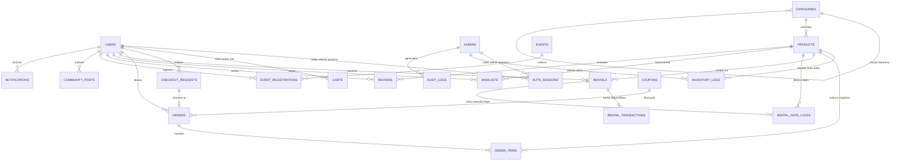

---

### 6.3 Complete Collection Specifications (22 Collections)

#### 1. `users`
- **Purpose:** Stores customer accounts, verification state, account status, and bounded saved delivery addresses.
- **Schema & Field Types:**
  - `_id`: `ObjectId` (PK, required)
  - `fullName`: `String` (required, 2–80 chars, trimmed)
  - `email`: `String` (required, unique, lowercase, trimmed)
  - `phone`: `String` (optional, E.164 format e.g. `+919876543210`, sparse unique)
  - `passwordHash`: `String` (required, `select: false`, bcrypt hash)
  - `avatar`: `{ url: String, publicId: String }` (optional)
  - `role`: `String` (required, enum `['CUSTOMER']`, default `'CUSTOMER'`)
  - `status`: `String` (required, enum `['PENDING_VERIFICATION', 'ACTIVE', 'SUSPENDED', 'DELETED']`, default `'PENDING_VERIFICATION'`)
  - `isEmailVerified`: `Boolean` (required, default `false`)
  - `isPhoneVerified`: `Boolean` (required, default `false`)
  - `emailVerificationTokenHash`: `String` (optional, `select: false`)
  - `emailVerificationExpiresAt`: `Date` (optional, `select: false`)
  - `passwordResetTokenHash`: `String` (optional, `select: false`)
  - `passwordResetExpiresAt`: `Date` (optional, `select: false`)
  - `failedLoginAttempts`: `Number` (required, default `0`)
  - `lockUntil`: `Date` (optional)
  - `tokenVersion`: `Number` (required, default `1` — incremented on password reset/suspend)
  - `addresses`: `Array<AddressSubdoc>` (optional, max 10 items): `{ _id: ObjectId, label: String, recipientName: String, phone: String, line1: String, line2: String, landmark: String, city: String, state: String, postalCode: String, country: String, isDefault: Boolean }`
  - `lastLoginAt`: `Date` (optional)
  - `createdAt`, `updatedAt`: `Date` (auto timestamps)
- **Validation Rules:** Email regex + RFC compliance; phone E.164 regex (`^\+[1-9]\d{7,14}$`); `addresses.length <= 10`; postalCode 6-digit validation for India (`^\d{6}$`) or configurable country pattern; only one address may have `isDefault: true`.
- **Relationships:** 1:N with `orders`, `rentals`, `checkoutRequests`, `wishlists`, `reviews`, `eventRegistrations`, `communityPosts`, `notifications`, `authSessions`; 1:1 active with `carts`.
- **Indexes:**
  - `{ email: 1 }` (`unique: true`)
  - `{ phone: 1 }` (`unique: true, sparse: true`)
  - `{ status: 1, createdAt: -1 }`
- **Example JSON Document:**
```json
{
  "_id": "6730a1b2c3d4e5f600000001",
  "fullName": "Aanya Sharma",
  "email": "aanya.sharma@example.com",
  "phone": "+919820112233",
  "role": "CUSTOMER",
  "status": "ACTIVE",
  "isEmailVerified": true,
  "isPhoneVerified": false,
  "failedLoginAttempts": 0,
  "tokenVersion": 1,
  "addresses": [
    {
      "_id": "6730a1b2c3d4e5f600000002",
      "label": "Home",
      "recipientName": "Aanya Sharma",
      "phone": "+919820112233",
      "line1": "14B Lotus Residency, Linking Road",
      "line2": "Bandra West",
      "city": "Mumbai",
      "state": "Maharashtra",
      "postalCode": "400050",
      "country": "IN",
      "isDefault": true
    }
  ],
  "lastLoginAt": "2026-11-10T08:15:00.000Z",
  "createdAt": "2026-10-01T10:00:00.000Z",
  "updatedAt": "2026-11-10T08:15:00.000Z"
}
```

#### 2. `admins`
- **Purpose:** Isolates Owner and future Staff accounts from the public `users` collection for stricter credential policies, permission scoping, and auditability.
- **Schema & Field Types:**
  - `_id`: `ObjectId` (PK, required)
  - `fullName`: `String` (required)
  - `email`: `String` (required, unique, lowercase)
  - `passwordHash`: `String` (required, `select: false`)
  - `role`: `String` (required, enum `['OWNER', 'STAFF']`)
  - `permissions`: `[String]` (required for `STAFF`; e.g., `['PRODUCTS_WRITE', 'ORDERS_MANAGE', 'RENTALS_MANAGE', 'COMMUNITY_MODERATE']`; `OWNER` bypasses granular check via `['*']`)
  - `isActive`: `Boolean` (required, default `true`)
  - `failedLoginAttempts`: `Number` (required, default `0`)
  - `lockUntil`: `Date` (optional)
  - `tokenVersion`: `Number` (required, default `1`)
  - `lastLoginAt`: `Date` (optional)
  - `createdBy`: `ObjectId` (ref `admins`, optional for seed Owner)
  - `createdAt`, `updatedAt`: `Date`
- **Validation Rules:** Minimum 12-character password policy enforced before hashing; `permissions` values constrained to `AdminPermissionEnum`.
- **Relationships:** Self-ref `createdBy -> admins`; 1:N with `auditLogs`, `inventoryLogs`, `authSessions`.
- **Indexes:** `{ email: 1 }` (`unique: true`), `{ role: 1, isActive: 1 }`.
- **Example JSON Document:**
```json
{
  "_id": "6730a1b2c3d4e5f600000010",
  "fullName": "Meera Kapoor",
  "email": "owner@circleup.in",
  "role": "OWNER",
  "permissions": ["*"],
  "isActive": true,
  "failedLoginAttempts": 0,
  "tokenVersion": 1,
  "lastLoginAt": "2026-11-10T09:00:00.000Z",
  "createdAt": "2026-09-15T06:00:00.000Z",
  "updatedAt": "2026-11-10T09:00:00.000Z"
}
```

#### 3. `authSessions`
- **Purpose:** Persists hashed refresh tokens for token rotation, reuse detection, multi-device visibility, and immediate session revocation.
- **Schema & Field Types:**
  - `_id`: `ObjectId` (PK, required)
  - `actorType`: `String` (required, enum `['CUSTOMER', 'ADMIN']`)
  - `actorId`: `ObjectId` (required, refPath `'actorModel'`)
  - `actorModel`: `String` (required, enum `['User', 'Admin']`)
  - `tokenFamilyId`: `String` (required, UUIDv4 — groups rotated tokens from a single login)
  - `refreshTokenHash`: `String` (required, SHA-256 hash of opaque token)
  - `userAgent`: `String` (optional, max 300 chars)
  - `ipAddress`: `String` (optional)
  - `isRevoked`: `Boolean` (required, default `false`)
  - `revokedReason`: `String` (optional, enum `['LOGOUT', 'ROTATED', 'REUSE_DETECTED', 'PASSWORD_RESET', 'ADMIN_SUSPENDED']`)
  - `expiresAt`: `Date` (required)
  - `createdAt`, `updatedAt`: `Date`
- **Validation Rules:** `expiresAt` must be in the future at creation.
- **Relationships:** Polymorphic N:1 to `users` or `admins`.
- **Indexes:**
  - `{ refreshTokenHash: 1 }` (`unique: true`)
  - `{ actorId: 1, actorType: 1, isRevoked: 1 }`
  - `{ tokenFamilyId: 1 }`
  - `{ expiresAt: 1 }` (MongoDB **TTL Index** `expireAfterSeconds: 0` for auto-cleanup!)
- **Example JSON Document:**
```json
{
  "_id": "6730a1b2c3d4e5f600000020",
  "actorType": "CUSTOMER",
  "actorId": "6730a1b2c3d4e5f600000001",
  "actorModel": "User",
  "tokenFamilyId": "f47ac10b-58cc-4372-a567-0e02b2c3d479",
  "refreshTokenHash": "9f86d081884c7d659a2feaa0c55ad015a3bf4f1b2b0b822cd15d6c15b0f00a08",
  "userAgent": "Mozilla/5.0 (Windows NT 10.0; Win64; x64)",
  "ipAddress": "103.21.124.10",
  "isRevoked": false,
  "expiresAt": "2026-11-17T08:15:00.000Z",
  "createdAt": "2026-11-10T08:15:00.000Z",
  "updatedAt": "2026-11-10T08:15:00.000Z"
}
```

#### 4. `categories`
- **Purpose:** Powers the storefront navigation (Women's Upperwear, Men's Bottomwear, Ethnic Wear, Jewellery, etc.), hierarchical subcategories, and SEO slugs.
- **Schema & Field Types:**
  - `_id`: `ObjectId` (PK, required)
  - `name`: `String` (required, 2–60 chars, trimmed)
  - `slug`: `String` (required, unique, lowercase kebab-case)
  - `description`: `String` (optional, max 500 chars)
  - `parentId`: `ObjectId` (ref `categories`, optional, `null` for top-level)
  - `ancestors`: `[{ _id: ObjectId, name: String, slug: String }]` (optional, materialized path for breadcrumbs)
  - `image`: `{ url: String, publicId: String }` (optional)
  - `displayOrder`: `Number` (required, default `0`)
  - `isActive`: `Boolean` (required, default `true`)
  - `createdAt`, `updatedAt`: `Date`
- **Validation Rules:** `parentId` cannot equal `_id`; slug matches `^[a-z0-9-]+$`.
- **Relationships:** Self-referencing hierarchy (`parentId`); 1:N with `products`.
- **Indexes:** `{ slug: 1 }` (`unique: true`), `{ parentId: 1, displayOrder: 1 }`, `{ isActive: 1 }`.
- **Example JSON Document:**
```json
{
  "_id": "6730a1b2c3d4e5f600000030",
  "name": "Women's Upperwear",
  "slug": "womens-upperwear",
  "description": "Curated pre-loved tops, shirts, blazers, and jackets.",
  "parentId": null,
  "ancestors": [],
  "image": {
    "url": "https://res.cloudinary.com/circleup/image/upload/v1/categories/womens-upper.webp",
    "publicId": "circleup/categories/womens-upper"
  },
  "displayOrder": 2,
  "isActive": true,
  "createdAt": "2026-09-20T08:00:00.000Z",
  "updatedAt": "2026-09-20T08:00:00.000Z"
}
```

#### 5. `products`
- **Purpose:** Master catalog supporting Pre-Loved, Fresh Finds, Rental, and Handcrafted products, single-unit vs. multi-unit stock variants, measurements, condition grading, and rental pricing config.
- **Schema & Field Types:**
  - `_id`: `ObjectId` (PK, required)
  - `title`: `String` (required, 3–140 chars)
  - `slug`: `String` (required, unique, lowercase)
  - `skuPrefix`: `String` (required, unique, e.g. `CU-PRE-0192`)
  - `description`: `String` (required, max 4000 chars)
  - `productType`: `String` (required, enum `['PRE_LOVED', 'FRESH_FINDS', 'RENTAL', 'HANDCRAFTED']`)
  - `inventoryMode`: `String` (required, enum `['SINGLE_UNIT', 'MULTI_UNIT']`)
  - `categoryId`: `ObjectId` (ref `categories`, required)
  - `subcategoryId`: `ObjectId` (ref `categories`, optional)
  - `brand`: `String` (optional, default `'Unbranded / Thrift'`)
  - `condition`: `String` (required for `PRE_LOVED`/`RENTAL`, enum `['NEW_WITH_TAGS', 'MINT', 'GENTLY_USED', 'VINTAGE_WEAR', 'NEW_ARTISAN']`)
  - `conditionNotes`: `String` (optional, flaws/wear transparency notes)
  - `measurements`: `Map<String, String>` (optional, e.g., `{ "chest": "38 in", "length": "25 in" }`)
  - `images`: `Array<{ url: String, publicId: String, altText: String, sortOrder: Number, isPrimary: Boolean }>` (required, min 1, max 10)
  - `price`: `Number` (required, integer `>= 0`, INR whole rupees e.g. `1850`; expandable to minor-unit paise if fractional pricing is introduced in Phase 2)
  - `originalPrice`: `Number` (optional, MSRP/compare-at price, must be `>= price` if set)
  - `variants`: `Array<VariantSubdoc>` (required, min 1):
    - `_id`: `ObjectId`
    - `sku`: `String` (required, globally unique via sparse/subdoc index `{ "variants.sku": 1 }`)
    - `size`: `String` (required, e.g. `'S'`, `'M'`, `'Free Size'`, `'UK 6'`)
    - `color`: `String` (optional)
    - `priceOverride`: `Number` (optional)
    - `stock`: `Number` (required, integer `>= 0`; max `1` when `inventoryMode === 'SINGLE_UNIT'`)
    - `reservedStock`: `Number` (required, integer `>= 0`, always `<= stock`)
    - `availableStock`: `Number` (required, integer `>= 0`, persisted atomic counter always equal to `stock - reservedStock`)
    - `isActive`: `Boolean` (required, default `true`)
  - `rentalConfig`: `Object` (required ONLY when `productType === 'RENTAL'`, null otherwise):
    - `baseChargePerDay`: `Number` (required, `> 0`)
    - `packages`: `[{ days: Number, totalCharge: Number }]` (optional tiered packages e.g. 3 days / 5 days)
    - `securityDeposit`: `Number` (required, `>= 0`)
    - `lateFeePerDay`: `Number` (required, `>= 0`)
    - `turnaroundBufferDays`: `Number` (required, integer `>= 0`, default `2`)
    - `minDays`: `Number` (required, default `2`)
    - `maxDays`: `Number` (required, default `14`)
    - `totalRentalUnits`: `Number` (required, integer `>= 1`, default `1`)
  - `tags`: `[String]` (optional, e.g. `['y2k', 'denim', 'thrifted-treasure']`)
  - `status`: `String` (required, enum `['DRAFT', 'ACTIVE', 'SOLD_OUT', 'ARCHIVED']`, default `'DRAFT'`)
  - `isNewArrival`: `Boolean` (required, default `true`)
  - `isFeatured`: `Boolean` (required, default `false`)
  - `ratingAvg`: `Number` (required, default `0`, 0–5)
  - `ratingCount`: `Number` (required, default `0`)
  - `totalSold`: `Number` (required, default `0`)
  - `createdBy`: `ObjectId` (ref `admins`, required)
  - `createdAt`, `updatedAt`: `Date`
- **Validation Rules:**
  - If `inventoryMode === 'SINGLE_UNIT'`: `variants.length === 1` and `variants[0].stock <= 1`.
  - If `productType === 'RENTAL'`: `rentalConfig` must be present; `variants[0].stock` mirrors `totalRentalUnits` or rental availability exclusively uses `rentalDateLocks`.
  - `reservedStock <= stock` and `availableStock === stock - reservedStock` invariants enforced on every variant.
- **Relationships:** N:1 `categories`; 1:N `inventoryLogs`, `orderItems`, `rentals`, `rentalDateLocks`, `reviews`, `wishlists`.
- **Indexes:**
  - `{ slug: 1 }` (`unique: true`)
  - `{ "variants.sku": 1 }` (`unique: true`)
  - `{ status: 1, productType: 1, categoryId: 1, createdAt: -1 }`
  - `{ status: 1, tags: 1, price: 1 }`
  - `{ title: "text", brand: "text", tags: "text", description: "text" }` (Text search index)
- **Example JSON Document:**
```json
{
  "_id": "6730a1b2c3d4e5f600000100",
  "title": "Vintage Levi's 90s Cropped Denim Jacket",
  "slug": "vintage-levis-90s-cropped-denim-jacket-0192",
  "skuPrefix": "CU-PRE-0192",
  "description": "Authentic washed indigo 90s cropped denim jacket. Single piece curated thrift treasure.",
  "productType": "PRE_LOVED",
  "inventoryMode": "SINGLE_UNIT",
  "categoryId": "6730a1b2c3d4e5f600000030",
  "brand": "Levi's",
  "condition": "MINT",
  "conditionNotes": "Natural vintage fade on collar; zero tears or stains.",
  "measurements": { "chest": "38 in", "length": "20 in" },
  "images": [
    {
      "url": "https://res.cloudinary.com/circleup/image/upload/v1/products/cu-pre-0192-1.webp",
      "publicId": "circleup/products/cu-pre-0192-1",
      "altText": "Vintage Levi's Denim Jacket Front",
      "sortOrder": 1,
      "isPrimary": true
    }
  ],
  "price": 1850,
  "originalPrice": 4500,
  "variants": [
    {
      "_id": "6730a1b2c3d4e5f600000101",
      "sku": "CU-PRE-0192-M",
      "size": "M",
      "color": "Washed Indigo",
      "stock": 1,
      "reservedStock": 0,
      "availableStock": 1,
      "isActive": true
    }
  ],
  "tags": ["thrifted-treasure", "denim", "90s"],
  "status": "ACTIVE",
  "isNewArrival": true,
  "isFeatured": true,
  "ratingAvg": 0,
  "ratingCount": 0,
  "totalSold": 0,
  "createdBy": "6730a1b2c3d4e5f600000010",
  "createdAt": "2026-11-08T11:00:00.000Z",
  "updatedAt": "2026-11-08T11:00:00.000Z"
}
```

#### 6. `carts`
- **Purpose:** Persists purchase shopping carts for authenticated customers and anonymous guests (via `guestSessionId`), generating unique backend `cartCode` identifiers for checkout tracking.
- **Schema & Field Types:**
  - `_id`: `ObjectId` (PK, required)
  - `cartCode`: `String` (required, unique, e.g. `CART-20261110-8F2A1C`)
  - `userId`: `ObjectId` (ref `users`, optional — sparse unique when active)
  - `guestSessionId`: `String` (optional — UUIDv4, sparse unique)
  - `status`: `String` (required, enum `['ACTIVE', 'MERGED', 'ABANDONED']`, default `'ACTIVE'`)
  - `items`: `Array<CartItemSubdoc>` (max 50):
    - `productId`: `ObjectId` (ref `products`, required)
    - `variantId`: `ObjectId` (required)
    - `sku`: `String` (required)
    - `quantity`: `Number` (required, integer `>= 1`)
    - `unitPriceAtAdd`: `Number` (required — informational; live price re-validated at checkout)
    - `addedAt`: `Date` (required)
  - `appliedCouponCode`: `String` (optional)
  - `expiresAt`: `Date` (optional — set to `now + 14 days` for Guest carts ONLY; `null` for logged-in Users)
  - `createdAt`, `updatedAt`: `Date`
- **Validation Rules:** Either `userId` or `guestSessionId` must be present; items cannot reference products with `productType === 'RENTAL'`; if product `inventoryMode === 'SINGLE_UNIT'`, `quantity` cannot exceed `1`.
- **Relationships:** N:1 `users`; N:M `products`.
- **Indexes:**
  - `{ cartCode: 1 }` (`unique: true`)
  - `{ userId: 1, status: 1 }` (`unique: true`, partialFilterExpression `{ userId: { $exists: true }, status: 'ACTIVE' }`)
  - `{ guestSessionId: 1, status: 1 }` (`unique: true`, partialFilterExpression `{ guestSessionId: { $exists: true }, status: 'ACTIVE' }`)
  - `{ expiresAt: 1 }` (TTL index `expireAfterSeconds: 0` — automatically purges expired guest carts).
- **Example JSON Document:**
```json
{
  "_id": "6730a1b2c3d4e5f600000200",
  "cartCode": "CART-20261110-8F2A1C",
  "userId": "6730a1b2c3d4e5f600000001",
  "status": "ACTIVE",
  "items": [
    {
      "productId": "6730a1b2c3d4e5f600000100",
      "variantId": "6730a1b2c3d4e5f600000101",
      "sku": "CU-PRE-0192-M",
      "quantity": 1,
      "unitPriceAtAdd": 1850,
      "addedAt": "2026-11-10T09:02:00.000Z"
    }
  ],
  "expiresAt": null,
  "createdAt": "2026-11-10T09:02:00.000Z",
  "updatedAt": "2026-11-10T09:02:00.000Z"
}
```

#### 7. `checkoutRequests`
- **Purpose:** Persists every WhatsApp checkout request **before** redirecting the user to WhatsApp, locking in a unique `requestCode` + `cartCode`, item price snapshots, delivery details, and owner confirmation state.
- **Schema & Field Types:**
  - `_id`: `ObjectId` (PK, required)
  - `requestCode`: `String` (required, unique, e.g. `CHK-20261110-4910`)
  - `cartId`: `ObjectId` (ref `carts`, required)
  - `cartCode`: `String` (required)
  - `userId`: `ObjectId` (ref `users`, optional if guest checkout allowed; preferred non-null)
  - `customerSnapshot`: `{ fullName: String, email: String, phone: String, isGuest: Boolean }` (required)
  - `deliveryAddressSnapshot`: `{ recipientName: String, phone: String, line1: String, line2: String, landmark: String, city: String, state: String, postalCode: String, country: String }` (required)
  - `itemsSnapshot`: `Array<{ productId: ObjectId, variantId: ObjectId, sku: String, title: String, size: String, color: String, imageUrl: String, productType: String, inventoryMode: String, quantity: Number, unitPrice: Number, lineTotal: Number }>` (required, min 1)
  - `couponCode`: `String` (optional)
  - `subtotal`: `Number` (required, `>= 0`)
  - `discountTotal`: `Number` (required, default `0`)
  - `shippingFee`: `Number` (required, default `0`)
  - `grandTotal`: `Number` (required, `>= 0`)
  - `customerNotes`: `String` (optional, max 500 chars)
  - `whatsappMessageText`: `String` (required — exact generated WhatsApp payload)
  - `whatsappDeepLink`: `String` (required)
  - `status`: `String` (required, enum `['INITIATED', 'RESERVED_AWAITING_PAYMENT', 'CONVERTED_TO_ORDER', 'REJECTED', 'EXPIRED', 'CANCELLED_BY_USER']`, default `'INITIATED'`)
  - `reservationExpiresAt`: `Date` (optional — set when owner moves status to `RESERVED_AWAITING_PAYMENT`)
  - `orderId`: `ObjectId` (ref `orders`, optional — set on conversion)
  - `reviewedBy`: `ObjectId` (ref `admins`, optional)
  - `reviewedAt`: `Date` (optional)
  - `rejectionReason`: `String` (optional)
  - `createdAt`, `updatedAt`: `Date`
- **Validation Rules:** `grandTotal === Math.max(0, subtotal - discountTotal + shippingFee)`; `itemsSnapshot.length >= 1`.
- **Relationships:** N:1 `users`, `carts`, `admins`; 1:1 optional `orders`.
- **Indexes:**
  - `{ requestCode: 1 }` (`unique: true`)
  - `{ status: 1, createdAt: -1 }`
  - `{ userId: 1, createdAt: -1 }`
  - `{ "itemsSnapshot.variantId": 1, status: 1 }` (Used to detect competing requests on unique thrift items!)
  - `{ reservationExpiresAt: 1 }` (`sparse: true`)
- **Example JSON Document:**
```json
{
  "_id": "6730a1b2c3d4e5f600000300",
  "requestCode": "CHK-20261110-4910",
  "cartId": "6730a1b2c3d4e5f600000200",
  "cartCode": "CART-20261110-8F2A1C",
  "userId": "6730a1b2c3d4e5f600000001",
  "customerSnapshot": {
    "fullName": "Aanya Sharma",
    "email": "aanya.sharma@example.com",
    "phone": "+919820112233",
    "isGuest": false
  },
  "deliveryAddressSnapshot": {
    "recipientName": "Aanya Sharma",
    "phone": "+919820112233",
    "line1": "14B Lotus Residency, Linking Road",
    "city": "Mumbai",
    "state": "Maharashtra",
    "postalCode": "400050",
    "country": "IN"
  },
  "itemsSnapshot": [
    {
      "productId": "6730a1b2c3d4e5f600000100",
      "variantId": "6730a1b2c3d4e5f600000101",
      "sku": "CU-PRE-0192-M",
      "title": "Vintage Levi's 90s Cropped Denim Jacket",
      "size": "M",
      "color": "Washed Indigo",
      "imageUrl": "https://res.cloudinary.com/circleup/image/upload/v1/products/cu-pre-0192-1.webp",
      "productType": "PRE_LOVED",
      "inventoryMode": "SINGLE_UNIT",
      "quantity": 1,
      "unitPrice": 1850,
      "lineTotal": 1850
    }
  ],
  "subtotal": 1850,
  "discountTotal": 0,
  "shippingFee": 99,
  "grandTotal": 1949,
  "whatsappMessageText": "Hi CircleUp! Checkout Ref: CHK-20261110-4910 (Cart: CART-20261110-8F2A1C)...",
  "whatsappDeepLink": "https://wa.me/919999999999?text=...",
  "status": "INITIATED",
  "createdAt": "2026-11-10T09:05:00.000Z",
  "updatedAt": "2026-11-10T09:05:00.000Z"
}
```

#### 8. `orders`
- **Purpose:** Master record for confirmed sales orders converted from `checkoutRequests` (or future online gateway), tracking payment settlement, fulfillment status history, courier tracking, and refunds.
- **Schema & Field Types:**
  - `_id`: `ObjectId` (PK, required)
  - `orderNumber`: `String` (required, unique, e.g. `ORD-20261110-1042`)
  - `checkoutRequestId`: `ObjectId` (ref `checkoutRequests`, required, unique)
  - `userId`: `ObjectId` (ref `users`, optional if guest order, indexed)
  - `customerSnapshot`: `{ fullName: String, email: String, phone: String }` (required)
  - `deliveryAddressSnapshot`: `{ recipientName: String, phone: String, line1: String, line2: String, landmark: String, city: String, state: String, postalCode: String, country: String }` (required)
  - `itemCount`: `Number` (required, `>= 1`)
  - `subtotal`: `Number` (required)
  - `discountTotal`: `Number` (required, default `0`)
  - `couponCode`: `String` (optional)
  - `shippingFee`: `Number` (required, default `0`)
  - `grandTotal`: `Number` (required)
  - `paymentMethod`: `String` (required, enum `['WHATSAPP_UPI', 'WHATSAPP_BANK_TRANSFER', 'CASH_ON_DELIVERY', 'RAZORPAY_FUTURE']`)
  - `paymentStatus`: `String` (required, enum `['PENDING', 'PAID', 'PARTIALLY_REFUNDED', 'REFUNDED', 'FAILED']`)
  - `paymentReference`: `String` (optional — UPI UTR / transaction ID entered by Owner)
  - `paidAt`: `Date` (optional)
  - `status`: `String` (required, enum `['CONFIRMED', 'PACKED', 'SHIPPED', 'OUT_FOR_DELIVERY', 'DELIVERED', 'CANCELLED', 'RETURN_REQUESTED', 'RETURNED', 'REFUNDED']`, default `'CONFIRMED'`)
  - `statusHistory`: `[{ status: String, note: String, changedByType: String, changedById: ObjectId, changedAt: Date }]` (required, min 1)
  - `trackingInfo`: `{ carrier: String, trackingNumber: String, trackingUrl: String, shippedAt: Date, estimatedDelivery: Date, deliveredAt: Date }` (optional)
  - `internalNotes`: `String` (optional, admin-only — NEVER exposed to Customer CRM!)
  - `cancellationInfo`: `{ reason: String, cancelledByType: String, cancelledById: ObjectId, cancelledAt: Date }` (optional)
  - `refundRecord`: `{ amount: Number, method: String, reference: String, reason: String, processedBy: ObjectId, processedAt: Date }` (optional)
  - `confirmedBy`: `ObjectId` (ref `admins`, required)
  - `createdAt`, `updatedAt`: `Date`
- **Validation Rules:** `refundRecord.amount <= grandTotal`; `statusHistory` append-only.
- **Relationships:** 1:1 `checkoutRequests`; N:1 `users`, `admins`, `coupons`; 1:N `orderItems`.
- **Indexes:**
  - `{ orderNumber: 1 }` (`unique: true`)
  - `{ checkoutRequestId: 1 }` (`unique: true`)
  - `{ userId: 1, createdAt: -1 }`
  - `{ status: 1, createdAt: -1 }`
  - `{ paymentStatus: 1, createdAt: -1 }`
- **Example JSON Document:**
```json
{
  "_id": "6730a1b2c3d4e5f600000400",
  "orderNumber": "ORD-20261110-1042",
  "checkoutRequestId": "6730a1b2c3d4e5f600000300",
  "userId": "6730a1b2c3d4e5f600000001",
  "customerSnapshot": { "fullName": "Aanya Sharma", "email": "aanya.sharma@example.com", "phone": "+919820112233" },
  "deliveryAddressSnapshot": { "recipientName": "Aanya Sharma", "phone": "+919820112233", "line1": "14B Lotus Residency", "city": "Mumbai", "state": "Maharashtra", "postalCode": "400050", "country": "IN" },
  "itemCount": 1,
  "subtotal": 1850,
  "discountTotal": 0,
  "shippingFee": 99,
  "grandTotal": 1949,
  "paymentMethod": "WHATSAPP_UPI",
  "paymentStatus": "PAID",
  "paymentReference": "UTR431590821923",
  "paidAt": "2026-11-10T09:20:00.000Z",
  "status": "PACKED",
  "statusHistory": [
    { "status": "CONFIRMED", "note": "UPI payment verified on WhatsApp", "changedByType": "ADMIN", "changedById": "6730a1b2c3d4e5f600000010", "changedAt": "2026-11-10T09:21:00.000Z" },
    { "status": "PACKED", "note": "Quality checked and packed", "changedByType": "ADMIN", "changedById": "6730a1b2c3d4e5f600000010", "changedAt": "2026-11-10T11:00:00.000Z" }
  ],
  "confirmedBy": "6730a1b2c3d4e5f600000010",
  "createdAt": "2026-11-10T09:21:00.000Z",
  "updatedAt": "2026-11-10T11:00:00.000Z"
}
```

#### 9. `orderItems` (Dedicated Collection — Explicitly Justified)
- **Justification for Separate Collection:** Separating line items into `orderItems` avoids expensive `$unwind` pipelines during Owner CRM bestseller/category analytics, supports item-level return/refund tracking without mutating parent order totals prematurely, and makes Customer verified-purchase review checks an O(1) indexed lookup (`{ userId, productId, itemStatus: 'DELIVERED' }`).
- **Purpose:** Stores immutable purchased product/variant/price snapshots per order line item.
- **Schema & Field Types:**
  - `_id`: `ObjectId` (PK, required)
  - `orderId`: `ObjectId` (ref `orders`, required)
  - `userId`: `ObjectId` (ref `users`, optional)
  - `productId`: `ObjectId` (ref `products`, required)
  - `variantId`: `ObjectId` (required)
  - `categoryId`: `ObjectId` (ref `categories`, required — fast category revenue analytics)
  - `productSnapshot`: `{ title: String, slug: String, sku: String, size: String, color: String, imageUrl: String, productType: String, condition: String }` (required)
  - `quantity`: `Number` (required, integer `>= 1`)
  - `unitPrice`: `Number` (required, `>= 0`)
  - `lineTotal`: `Number` (required, `quantity * unitPrice`)
  - `itemStatus`: `String` (required, enum `['ACTIVE', 'CANCELLED', 'RETURNED', 'REFUNDED']`, default `'ACTIVE'`)
  - `orderFulfillmentStatus`: `String` (required, synced with parent `orders.status` for verified-purchase queries)
  - `createdAt`, `updatedAt`: `Date`
- **Validation Rules:** `lineTotal === quantity * unitPrice`.
- **Relationships:** N:1 `orders`, `users`, `products`, `categories`.
- **Indexes:**
  - `{ orderId: 1 }`
  - `{ userId: 1, productId: 1, orderFulfillmentStatus: 1 }` (Fast verified-purchase review check!)
  - `{ productId: 1, createdAt: -1 }` (Bestseller aggregation!)
  - `{ categoryId: 1, createdAt: -1 }`
- **Example JSON Document:**
```json
{
  "_id": "6730a1b2c3d4e5f600000450",
  "orderId": "6730a1b2c3d4e5f600000400",
  "userId": "6730a1b2c3d4e5f600000001",
  "productId": "6730a1b2c3d4e5f600000100",
  "variantId": "6730a1b2c3d4e5f600000101",
  "categoryId": "6730a1b2c3d4e5f600000030",
  "productSnapshot": {
    "title": "Vintage Levi's 90s Cropped Denim Jacket",
    "slug": "vintage-levis-90s-cropped-denim-jacket-0192",
    "sku": "CU-PRE-0192-M",
    "size": "M",
    "color": "Washed Indigo",
    "imageUrl": "https://res.cloudinary.com/circleup/image/upload/v1/products/cu-pre-0192-1.webp",
    "productType": "PRE_LOVED",
    "condition": "MINT"
  },
  "quantity": 1,
  "unitPrice": 1850,
  "lineTotal": 1850,
  "itemStatus": "ACTIVE",
  "orderFulfillmentStatus": "PACKED",
  "createdAt": "2026-11-10T09:21:00.000Z",
  "updatedAt": "2026-11-10T09:21:00.000Z"
}
```

#### 10. `rentals`
- **Purpose:** Manages the full lifecycle of rental requests and active bookings separately from purchase orders, including dates, cleaning turnaround buffers, security deposits, actual return dates, late fees, and damage assessments.
- **Schema & Field Types:**
  - `_id`: `ObjectId` (PK, required)
  - `rentalNumber`: `String` (required, unique, e.g. `RNT-20261110-2201`)
  - `userId`: `ObjectId` (ref `users`, required — rentals require verified customer account!)
  - `productId`: `ObjectId` (ref `products`, required)
  - `variantId`: `ObjectId` (required)
  - `unitIndex`: `Number` (optional — assigned `0 .. totalRentalUnits - 1` upon Owner approval)
  - `productSnapshot`: `{ title: String, sku: String, size: String, imageUrl: String }` (required)
  - `deliveryAddressSnapshot`: `AddressSnapshot` (required)
  - `startDate`: `Date` (required — normalized UTC 00:00:00 of IST rental start date)
  - `endDate`: `Date` (required — normalized UTC 00:00:00 of rental end date)
  - `turnaroundBufferDays`: `Number` (required, default `2`)
  - `effectiveBlockedUntil`: `Date` (required — `endDate + turnaroundBufferDays`)
  - `durationDays`: `Number` (required, `>= 1`)
  - `actualReturnDate`: `Date` (optional)
  - `pricingSnapshot`: `{ rentalCharge: Number, securityDeposit: Number, lateFeePerDay: Number, totalInitialPayable: Number }` (required)
  - `chargesSummary`: `{ lateDays: Number, lateFeeCharged: Number, damageFeeCharged: Number, depositRefundableAmount: Number, depositRefundedAmount: Number }` (required, defaults `0` until return inspection)
  - `status`: `String` (required, enum `['REQUESTED', 'APPROVED', 'DEPOSIT_PAID', 'DISPATCHED', 'ACTIVE', 'EXTENDED', 'OVERDUE', 'RETURNED_INSPECTING', 'COMPLETED', 'REJECTED', 'CANCELLED']`, default `'REQUESTED'`)
  - `statusHistory`: `[{ status: String, note: String, changedById: ObjectId, changedAt: Date }]` (required)
  - `customerNotes`: `String` (optional)
  - `inspectionNotes`: `String` (optional, admin check-in findings)
  - `whatsappDeepLink`: `String` (optional)
  - `approvedBy`: `ObjectId` (ref `admins`, optional)
  - `createdAt`, `updatedAt`: `Date`
- **Validation Rules:** `endDate >= startDate`; `durationDays` within product `minDays..maxDays`; `damageFeeCharged + lateFeeCharged <= securityDeposit` (or extra balance tracked if exceeding deposit!).
- **Relationships:** N:1 `users`, `products`, `admins`; 1:N `rentalTransactions`, `rentalDateLocks`.
- **Indexes:**
  - `{ rentalNumber: 1 }` (`unique: true`)
  - `{ userId: 1, createdAt: -1 }`
  - `{ productId: 1, status: 1, startDate: 1, effectiveBlockedUntil: 1 }`
  - `{ status: 1, endDate: 1 }` (Overdue cron query!)
- **Example JSON Document:**
```json
{
  "_id": "6730a1b2c3d4e5f600000500",
  "rentalNumber": "RNT-20261110-2201",
  "userId": "6730a1b2c3d4e5f600000001",
  "productId": "6730a1b2c3d4e5f600000150",
  "variantId": "6730a1b2c3d4e5f600000151",
  "unitIndex": 0,
  "productSnapshot": {
    "title": "Sabyasachi-Inspired Embroidered Velvet Lehenga",
    "sku": "CU-RNT-0041-M",
    "size": "M",
    "imageUrl": "https://res.cloudinary.com/circleup/image/upload/v1/products/cu-rnt-0041.webp"
  },
  "deliveryAddressSnapshot": { "recipientName": "Aanya Sharma", "phone": "+919820112233", "line1": "14B Lotus Residency", "city": "Mumbai", "state": "Maharashtra", "postalCode": "400050", "country": "IN" },
  "startDate": "2026-11-20T00:00:00.000Z",
  "endDate": "2026-11-23T00:00:00.000Z",
  "turnaroundBufferDays": 2,
  "effectiveBlockedUntil": "2026-11-25T00:00:00.000Z",
  "durationDays": 4,
  "pricingSnapshot": { "rentalCharge": 2400, "securityDeposit": 3000, "lateFeePerDay": 400, "totalInitialPayable": 5400 },
  "chargesSummary": { "lateDays": 0, "lateFeeCharged": 0, "damageFeeCharged": 0, "depositRefundableAmount": 3000, "depositRefundedAmount": 0 },
  "status": "APPROVED",
  "statusHistory": [
    { "status": "REQUESTED", "note": "Requested via rental calendar", "changedById": "6730a1b2c3d4e5f600000001", "changedAt": "2026-11-10T08:30:00.000Z" },
    { "status": "APPROVED", "note": "Dates confirmed available", "changedById": "6730a1b2c3d4e5f600000010", "changedAt": "2026-11-10T09:10:00.000Z" }
  ],
  "approvedBy": "6730a1b2c3d4e5f600000010",
  "createdAt": "2026-11-10T08:30:00.000Z",
  "updatedAt": "2026-11-10T09:10:00.000Z"
}
```

#### 11. `rentalTransactions`
- **Purpose:** Append-only financial ledger recording every rental fee payment, deposit collection, late/damage deduction, and deposit refund.
- **Schema & Field Types:**
  - `_id`: `ObjectId` (PK, required)
  - `rentalId`: `ObjectId` (ref `rentals`, required)
  - `userId`: `ObjectId` (ref `users`, required)
  - `type`: `String` (required, enum `['RENTAL_FEE_PAID', 'DEPOSIT_COLLECTED', 'LATE_FEE_ASSESSED', 'DAMAGE_FEE_ASSESSED', 'DEPOSIT_REFUNDED', 'DEPOSIT_FORFEITED']`)
  - `direction`: `String` (required, enum `['CREDIT_FROM_CUSTOMER', 'DEBIT_TO_CUSTOMER', 'DEDUCTION_FROM_DEPOSIT']`)
  - `amount`: `Number` (required, `> 0`)
  - `paymentMethod`: `String` (required, enum `['WHATSAPP_UPI', 'BANK_TRANSFER', 'CASH', 'DEPOSIT_OFFSET', 'RAZORPAY_FUTURE']`)
  - `reference`: `String` (optional — UTR / refund ref)
  - `notes`: `String` (optional)
  - `recordedBy`: `ObjectId` (ref `admins`, required)
  - `createdAt`: `Date` (required)
- **Validation Rules:** Immutable after insert (`updatedAt` disabled); `amount > 0`.
- **Relationships:** N:1 `rentals`, `users`, `admins`.
- **Indexes:** `{ rentalId: 1, createdAt: 1 }`, `{ userId: 1, createdAt: -1 }`, `{ type: 1, createdAt: -1 }`.
- **Example JSON Document:**
```json
{
  "_id": "6730a1b2c3d4e5f600000550",
  "rentalId": "6730a1b2c3d4e5f600000500",
  "userId": "6730a1b2c3d4e5f600000001",
  "type": "DEPOSIT_COLLECTED",
  "direction": "CREDIT_FROM_CUSTOMER",
  "amount": 3000,
  "paymentMethod": "WHATSAPP_UPI",
  "reference": "UTR431591100291",
  "notes": "Security deposit collected with rental charge",
  "recordedBy": "6730a1b2c3d4e5f600000010",
  "createdAt": "2026-11-10T09:15:00.000Z"
}
```

#### 12. `rentalDateLocks`
- **Purpose:** Enforces database-level mutual exclusion per unit per calendar day (`YYYY-MM-DD`) so concurrent MongoDB transactions can never double-book overlapping rental intervals.
- **Schema & Field Types:**
  - `_id`: `ObjectId` (PK, required)
  - `productId`: `ObjectId` (ref `products`, required)
  - `variantId`: `ObjectId` (required)
  - `unitIndex`: `Number` (required, integer `>= 0`, `0` for unique items)
  - `dateKey`: `String` (required, `'YYYY-MM-DD'` in store timezone `Asia/Kolkata`)
  - `rentalId`: `ObjectId` (ref `rentals`, required)
  - `lockKind`: `String` (required, enum `['RENTAL_DAY', 'TURNAROUND_BUFFER']`)
  - `createdAt`: `Date`
- **Validation Rules:** `dateKey` matches `^\d{4}-\d{2}-\d{2}$`.
- **Relationships:** N:1 `products`, `rentals`.
- **Indexes:**
  - `{ productId: 1, variantId: 1, unitIndex: 1, dateKey: 1 }` (`unique: true` — physical anti-double-booking guard!)
  - `{ rentalId: 1 }` (Fast deletion on cancellation/early return).
- **Example JSON Document:**
```json
{
  "_id": "6730a1b2c3d4e5f600000580",
  "productId": "6730a1b2c3d4e5f600000150",
  "variantId": "6730a1b2c3d4e5f600000151",
  "unitIndex": 0,
  "dateKey": "2026-11-20",
  "rentalId": "6730a1b2c3d4e5f600000500",
  "lockKind": "RENTAL_DAY",
  "createdAt": "2026-11-10T09:10:00.000Z"
}
```

#### 13. `wishlists`
- **Purpose:** Stores customer-saved products cleanly with pagination and instant duplicate checks without risking 16MB array bloat.
- **Schema & Field Types:**
  - `_id`: `ObjectId` (PK, required)
  - `userId`: `ObjectId` (ref `users`, required)
  - `productId`: `ObjectId` (ref `products`, required)
  - `variantId`: `ObjectId` (optional)
  - `createdAt`: `Date`
- **Validation Rules:** Unique per `(userId, productId)`.
- **Relationships:** N:1 `users`, `products`.
- **Indexes:**
  - `{ userId: 1, productId: 1 }` (`unique: true`)
  - `{ userId: 1, createdAt: -1 }`
- **Example JSON Document:**
```json
{
  "_id": "6730a1b2c3d4e5f600000600",
  "userId": "6730a1b2c3d4e5f600000001",
  "productId": "6730a1b2c3d4e5f600000100",
  "variantId": "6730a1b2c3d4e5f600000101",
  "createdAt": "2026-11-09T14:22:00.000Z"
}
```

#### 14. `reviews`
- **Purpose:** Stores product and general platform reviews, verified-purchase linkage (`orderItems` or `rentals`), moderation status, and admin replies.
- **Schema & Field Types:**
  - `_id`: `ObjectId` (PK, required)
  - `userId`: `ObjectId` (ref `users`, required)
  - `targetType`: `String` (required, enum `['PRODUCT', 'STORE']`)
  - `productId`: `ObjectId` (ref `products`, required if `targetType === 'PRODUCT'`, null otherwise)
  - `orderItemId`: `ObjectId` (ref `orderItems`, optional — proof for purchase verification)
  - `rentalId`: `ObjectId` (ref `rentals`, optional — proof for rental verification)
  - `isVerifiedPurchase`: `Boolean` (required, computed server-side from delivered `orderItems` or completed `rentals`)
  - `rating`: `Number` (required, integer `1..5`)
  - `title`: `String` (optional, max 100 chars)
  - `comment`: `String` (required, 10–1000 chars)
  - `images`: `[{ url: String, publicId: String }]` (optional, max 3)
  - `moderationStatus`: `String` (required, enum `['PENDING', 'APPROVED', 'REJECTED']`, default `'PENDING'`)
  - `adminReply`: `{ text: String, repliedBy: ObjectId, repliedAt: Date }` (optional)
  - `moderatedBy`: `ObjectId` (ref `admins`, optional)
  - `moderatedAt`: `Date` (optional)
  - `createdAt`, `updatedAt`: `Date`
- **Validation Rules:** One review per user per product (`partialFilterExpression` when `targetType === 'PRODUCT'`); `rating` integer 1–5; `isVerifiedPurchase` cannot be set by client payload.
- **Relationships:** N:1 `users`, `products`, `orderItems`, `rentals`, `admins`.
- **Indexes:**
  - `{ productId: 1, moderationStatus: 1, createdAt: -1 }`
  - `{ userId: 1, productId: 1 }` (`unique: true`, partialFilterExpression `{ productId: { $exists: true } }`)
  - `{ moderationStatus: 1, createdAt: -1 }`
- **Example JSON Document:**
```json
{
  "_id": "6730a1b2c3d4e5f600000700",
  "userId": "6730a1b2c3d4e5f600000001",
  "targetType": "PRODUCT",
  "productId": "6730a1b2c3d4e5f600000100",
  "orderItemId": "6730a1b2c3d4e5f600000450",
  "isVerifiedPurchase": true,
  "rating": 5,
  "title": "Mint condition vintage find!",
  "comment": "Fabric quality exceeded expectations and fit exactly as measured.",
  "images": [],
  "moderationStatus": "APPROVED",
  "moderatedBy": "6730a1b2c3d4e5f600000010",
  "createdAt": "2026-11-18T12:00:00.000Z",
  "updatedAt": "2026-11-18T13:00:00.000Z"
}
```

#### 15. `events`
- **Purpose:** Powers *The Social Circle* community events (thrift swap meets, styling workshops, pop-up exhibitions) with capacity tracking.
- **Schema & Field Types:**
  - `_id`: `ObjectId` (PK, required)
  - `title`: `String` (required, 3–120 chars)
  - `slug`: `String` (required, unique)
  - `summary`: `String` (required, max 300 chars)
  - `description`: `String` (required, max 5000 chars)
  - `eventType`: `String` (required, enum `['SWAP_MEET', 'POP_UP', 'WORKSHOP', 'COMMUNITY_CIRCLE']`)
  - `bannerImage`: `{ url: String, publicId: String }` (required)
  - `venue`: `{ mode: String, address: String, city: String, mapUrl: String, meetingLink: String }` (`mode`: `'IN_PERSON' | 'ONLINE'`)
  - `startsAt`: `Date` (required)
  - `endsAt`: `Date` (required)
  - `registrationDeadline`: `Date` (required)
  - `capacity`: `Number` (required, integer `>= 1`)
  - `registeredCount`: `Number` (required, integer `>= 0`, maintained atomically `<= capacity`)
  - `ticketPrice`: `Number` (required, `>= 0`, `0` for free)
  - `status`: `String` (required, enum `['DRAFT', 'PUBLISHED', 'CLOSED', 'CANCELLED', 'COMPLETED']`, default `'DRAFT'`)
  - `createdBy`: `ObjectId` (ref `admins`, required)
  - `createdAt`, `updatedAt`: `Date`
- **Validation Rules:** `endsAt > startsAt`; `registeredCount <= capacity`.
- **Relationships:** N:1 `admins`; 1:N `eventRegistrations`.
- **Indexes:** `{ slug: 1 }` (`unique: true`), `{ status: 1, startsAt: 1 }`.
- **Example JSON Document:**
```json
{
  "_id": "6730a1b2c3d4e5f600000800",
  "title": "The Social Circle: Bandra Winter Thrift Swap",
  "slug": "bandra-winter-thrift-swap-dec-2026",
  "summary": "Bring up to 5 clean pre-loved pieces and swap with the community.",
  "description": "Curated evening swap, styling circle, and sustainable fashion talk.",
  "eventType": "SWAP_MEET",
  "bannerImage": { "url": "https://res.cloudinary.com/circleup/image/upload/v1/events/swap.webp", "publicId": "circleup/events/swap" },
  "venue": { "mode": "IN_PERSON", "address": "16th Road Studio, Bandra West", "city": "Mumbai" },
  "startsAt": "2026-12-06T11:30:00.000Z",
  "endsAt": "2026-12-06T15:30:00.000Z",
  "registrationDeadline": "2026-12-05T18:00:00.000Z",
  "capacity": 40,
  "registeredCount": 18,
  "ticketPrice": 0,
  "status": "PUBLISHED",
  "createdBy": "6730a1b2c3d4e5f600000010",
  "createdAt": "2026-11-05T10:00:00.000Z",
  "updatedAt": "2026-11-10T08:00:00.000Z"
}
```

#### 16. `eventRegistrations`
- **Purpose:** Tracks customer registrations, unique ticket codes, and attendance/cancellations for *The Social Circle* events.
- **Schema & Field Types:**
  - `_id`: `ObjectId` (PK, required)
  - `eventId`: `ObjectId` (ref `events`, required)
  - `userId`: `ObjectId` (ref `users`, required)
  - `registrationCode`: `String` (required, unique, e.g. `EVT-20261206-91A2`)
  - `attendeeSnapshot`: `{ fullName: String, email: String, phone: String }` (required)
  - `notes`: `String` (optional)
  - `status`: `String` (required, enum `['REGISTERED', 'CANCELLED', 'ATTENDED', 'NO_SHOW']`, default `'REGISTERED'`)
  - `cancelledAt`: `Date` (optional)
  - `createdAt`, `updatedAt`: `Date`
- **Validation Rules:** One active registration per `(eventId, userId)`.
- **Relationships:** N:1 `events`, `users`.
- **Indexes:**
  - `{ eventId: 1, userId: 1 }` (`unique: true`, partialFilterExpression `{ status: { $ne: 'CANCELLED' } }`)
  - `{ registrationCode: 1 }` (`unique: true`)
  - `{ userId: 1, createdAt: -1 }`
- **Example JSON Document:**
```json
{
  "_id": "6730a1b2c3d4e5f600000850",
  "eventId": "6730a1b2c3d4e5f600000800",
  "userId": "6730a1b2c3d4e5f600000001",
  "registrationCode": "EVT-20261206-91A2",
  "attendeeSnapshot": { "fullName": "Aanya Sharma", "email": "aanya.sharma@example.com", "phone": "+919820112233" },
  "status": "REGISTERED",
  "createdAt": "2026-11-10T08:40:00.000Z",
  "updatedAt": "2026-11-10T08:40:00.000Z"
}
```

#### 17. `communityPosts`
- **Purpose:** Stores `#ThriftCrew` customer style submissions with mandatory explicit image usage consent and strict owner moderation before public publishing.
- **Schema & Field Types:**
  - `_id`: `ObjectId` (PK, required)
  - `userId`: `ObjectId` (ref `users`, required)
  - `authorHandle`: `String` (required, e.g. `@aanya.styles`)
  - `caption`: `String` (required, 5–400 chars)
  - `media`: `Array<{ url: String, publicId: String, altText: String }>` (required, min 1, max 4)
  - `taggedProductIds`: `[ObjectId]` (ref `products`, optional, max 5)
  - `consentRecord`: `{ granted: Boolean, policyVersion: String, consentedAt: Date, ipAddress: String, allowSocialRepost: Boolean }` (required — `granted` MUST be `true`)
  - `moderationStatus`: `String` (required, enum `['PENDING', 'APPROVED', 'REJECTED']`, default `'PENDING'`)
  - `isFeatured`: `Boolean` (required, default `false`)
  - `rejectionReason`: `String` (optional)
  - `moderatedBy`: `ObjectId` (ref `admins`, optional)
  - `publishedAt`: `Date` (optional — set only when `moderationStatus` becomes `'APPROVED'`)
  - `createdAt`, `updatedAt`: `Date`
- **Validation Rules:** `consentRecord.granted === true` enforced in Zod + Mongoose pre-save; `publishedAt` remains null while `PENDING`/`REJECTED`.
- **Relationships:** N:1 `users`, `admins`; N:M `products`.
- **Indexes:**
  - `{ moderationStatus: 1, isFeatured: -1, publishedAt: -1 }`
  - `{ userId: 1, createdAt: -1 }`
- **Example JSON Document:**
```json
{
  "_id": "6730a1b2c3d4e5f600000900",
  "userId": "6730a1b2c3d4e5f600000001",
  "authorHandle": "@aanya.styles",
  "caption": "Styled my 90s Levi's thrift find for Sunday coffee!",
  "media": [
    { "url": "https://res.cloudinary.com/circleup/image/upload/v1/community/post1.webp", "publicId": "circleup/community/post1", "altText": "Denim jacket street look" }
  ],
  "taggedProductIds": ["6730a1b2c3d4e5f600000100"],
  "consentRecord": {
    "granted": true,
    "policyVersion": "v1.0-2026",
    "consentedAt": "2026-11-10T09:30:00.000Z",
    "ipAddress": "103.21.124.10",
    "allowSocialRepost": true
  },
  "moderationStatus": "PENDING",
  "isFeatured": false,
  "createdAt": "2026-11-10T09:30:00.000Z",
  "updatedAt": "2026-11-10T09:30:00.000Z"
}
```

#### 18. `notifications`
- **Purpose:** Stores in-app notifications for both Customers and Admins alongside email dispatch tracking and retry metadata.
- **Schema & Field Types:**
  - `_id`: `ObjectId` (PK, required)
  - `recipientType`: `String` (required, enum `['CUSTOMER', 'ADMIN']`)
  - `recipientId`: `ObjectId` (required)
  - `eventType`: `String` (required, enum `['WELCOME_VERIFIED', 'ORDER_CONFIRMED', 'ORDER_STATUS_CHANGED', 'RENTAL_APPROVED', 'RENTAL_REJECTED', 'RENTAL_RETURN_REMINDER', 'RENTAL_OVERDUE', 'EVENT_REGISTERED', 'COMMUNITY_POST_APPROVED', 'COMMUNITY_POST_REJECTED', 'ADMIN_NEW_CHECKOUT', 'ADMIN_NEW_RENTAL', 'ADMIN_RENTAL_OVERDUE']`)
  - `title`: `String` (required, max 120 chars)
  - `body`: `String` (required, max 500 chars)
  - `actionUrl`: `String` (optional, deep link inside Customer/Owner CRM)
  - `reference`: `{ entityType: String, entityId: ObjectId }` (optional)
  - `isRead`: `Boolean` (required, default `false`)
  - `readAt`: `Date` (optional)
  - `channels`: `{ inApp: Boolean, emailStatus: String, emailAttempts: Number, lastEmailError: String, emailSentAt: Date }` (`emailStatus`: `'NONE' | 'PENDING' | 'SENT' | 'FAILED'`)
  - `createdAt`: `Date`
- **Validation Rules:** `emailAttempts >= 0`.
- **Relationships:** Polymorphic N:1 `users` / `admins`.
- **Indexes:**
  - `{ recipientType: 1, recipientId: 1, isRead: 1, createdAt: -1 }`
  - `{ "channels.emailStatus": 1, "channels.emailAttempts": 1 }` (Email retry worker)
  - `{ createdAt: 1 }` (Optional TTL after 180 days to bound growth).
- **Example JSON Document:**
```json
{
  "_id": "6730a1b2c3d4e5f600000950",
  "recipientType": "CUSTOMER",
  "recipientId": "6730a1b2c3d4e5f600000001",
  "eventType": "ORDER_CONFIRMED",
  "title": "Order ORD-20261110-1042 Confirmed",
  "body": "We received your payment and your order is now being packed.",
  "actionUrl": "/account/orders/6730a1b2c3d4e5f600000400",
  "reference": { "entityType": "Order", "entityId": "6730a1b2c3d4e5f600000400" },
  "isRead": false,
  "channels": { "inApp": true, "emailStatus": "SENT", "emailAttempts": 1, "emailSentAt": "2026-11-10T09:21:05.000Z" },
  "createdAt": "2026-11-10T09:21:00.000Z"
}
```

#### 19. `inventoryLogs`
- **Purpose:** Immutable audit ledger capturing every inventory movement (initial stock, reservations, deductions, cancellations, returns, manual adjustments).
- **Schema & Field Types:**
  - `_id`: `ObjectId` (PK, required)
  - `productId`: `ObjectId` (ref `products`, required)
  - `variantId`: `ObjectId` (required)
  - `sku`: `String` (required)
  - `action`: `String` (required, enum `['INITIAL_STOCK', 'RESERVE', 'RELEASE_RESERVATION', 'DEDUCT_SALE', 'RESTORE_CANCEL', 'RESTORE_RETURN', 'MANUAL_ADJUST', 'ARCHIVE_ZERO']`)
  - `quantityDelta`: `Number` (required — positive or negative integer)
  - `stockBefore`: `Number` (required)
  - `stockAfter`: `Number` (required)
  - `reservedBefore`: `Number` (required)
  - `reservedAfter`: `Number` (required)
  - `referenceType`: `String` (optional, enum `['CHECKOUT_REQUEST', 'ORDER', 'ADMIN_MANUAL', 'CRON_EXPIRY']`)
  - `referenceId`: `ObjectId` (optional)
  - `actorType`: `String` (required, enum `['ADMIN', 'SYSTEM']`)
  - `actorId`: `ObjectId` (optional)
  - `note`: `String` (optional, max 300 chars)
  - `createdAt`: `Date` (required)
- **Validation Rules:** Append-only (`updatedAt` disabled); `stockAfter >= 0` and `reservedAfter >= 0`.
- **Relationships:** N:1 `products`, `admins`.
- **Indexes:**
  - `{ productId: 1, createdAt: -1 }`
  - `{ sku: 1, createdAt: -1 }`
  - `{ referenceType: 1, referenceId: 1 }`
- **Example JSON Document:**
```json
{
  "_id": "6730a1b2c3d4e5f600001000",
  "productId": "6730a1b2c3d4e5f600000100",
  "variantId": "6730a1b2c3d4e5f600000101",
  "sku": "CU-PRE-0192-M",
  "action": "DEDUCT_SALE",
  "quantityDelta": -1,
  "stockBefore": 1,
  "stockAfter": 0,
  "reservedBefore": 0,
  "reservedAfter": 0,
  "referenceType": "ORDER",
  "referenceId": "6730a1b2c3d4e5f600000400",
  "actorType": "ADMIN",
  "actorId": "6730a1b2c3d4e5f600000010",
  "note": "Order ORD-20261110-1042 confirmed from CHK-20261110-4910",
  "createdAt": "2026-11-10T09:21:00.000Z"
}
```

#### 20. `siteContent`
- **Purpose:** Key-value structured CMS powering Homepage hero/banners, About Us, Contact info, store settings, and legal Policies managed via Owner CRM.
- **Schema & Field Types:**
  - `_id`: `ObjectId` (PK, required)
  - `key`: `String` (required, unique, enum `['HOME_HERO', 'HOME_PROMO_STRIP', 'ABOUT_US', 'CONTACT_INFO', 'POLICY_TERMS', 'POLICY_PRIVACY', 'POLICY_RENTAL', 'POLICY_RETURNS', 'STORE_OPERATIONS']`)
  - `title`: `String` (required)
  - `payload`: `Mixed` (validated per `key` by discriminated Zod schemas in CMS service — e.g., hero banners array, markdown policy text, WhatsApp business phone, default rental buffer days)
  - `version`: `Number` (required, default `1`)
  - `isPublished`: `Boolean` (required, default `true`)
  - `updatedBy`: `ObjectId` (ref `admins`, required)
  - `createdAt`, `updatedAt`: `Date`
- **Validation Rules:** Per-`key` strict Zod validation before persistence.
- **Relationships:** N:1 `admins`.
- **Indexes:** `{ key: 1 }` (`unique: true`).
- **Example JSON Document:**
```json
{
  "_id": "6730a1b2c3d4e5f600001100",
  "key": "STORE_OPERATIONS",
  "title": "Store Operations Config",
  "payload": {
    "whatsappBusinessNumber": "919999999999",
    "defaultShippingFee": 99,
    "freeShippingThreshold": 2499,
    "defaultRentalBufferDays": 2,
    "reservationExpiryHours": 24
  },
  "version": 3,
  "isPublished": true,
  "updatedBy": "6730a1b2c3d4e5f600000010",
  "createdAt": "2026-09-20T08:00:00.000Z",
  "updatedAt": "2026-11-01T12:00:00.000Z"
}
```

#### 21. `auditLogs`
- **Purpose:** Tamper-evident operational and security audit log recording every administrative mutation and sensitive customer security event.
- **Schema & Field Types:**
  - `_id`: `ObjectId` (PK, required)
  - `actorType`: `String` (required, enum `['ADMIN', 'CUSTOMER', 'SYSTEM']`)
  - `actorId`: `ObjectId` (optional)
  - `actorEmail`: `String` (optional)
  - `action`: `String` (required, e.g. `'ORDER_CONFIRMED'`, `'RENTAL_APPROVED'`, `'PRODUCT_PRICE_UPDATED'`, `'CUSTOMER_SUSPENDED'`, `'ADMIN_LOGIN_FAILED'`)
  - `resourceType`: `String` (required, e.g. `'Order'`, `'Product'`, `'Rental'`, `'User'`, `'SiteContent'`)
  - `resourceId`: `String` (optional)
  - `changes`: `{ before: Mixed, after: Mixed }` (optional — redacted of secrets)
  - `ipAddress`: `String` (optional)
  - `userAgent`: `String` (optional)
  - `requestId`: `String` (required — correlates with Pino HTTP logs)
  - `createdAt`: `Date` (required)
- **Validation Rules:** Append-only; API exposes read-only paginated queries to `OWNER` only (no update/delete endpoints!).
- **Relationships:** N:1 `admins` / `users`.
- **Indexes:**
  - `{ createdAt: -1 }`
  - `{ actorId: 1, createdAt: -1 }`
  - `{ resourceType: 1, resourceId: 1, createdAt: -1 }`
  - `{ action: 1, createdAt: -1 }`
- **Example JSON Document:**
```json
{
  "_id": "6730a1b2c3d4e5f600001200",
  "actorType": "ADMIN",
  "actorId": "6730a1b2c3d4e5f600000010",
  "actorEmail": "owner@circleup.in",
  "action": "ORDER_CONFIRMED",
  "resourceType": "Order",
  "resourceId": "6730a1b2c3d4e5f600000400",
  "changes": { "before": { "checkoutStatus": "INITIATED" }, "after": { "orderStatus": "CONFIRMED", "paymentStatus": "PAID" } },
  "ipAddress": "103.21.124.55",
  "requestId": "req-8c42b19a",
  "createdAt": "2026-11-10T09:21:00.000Z"
}
```

#### 22. `coupons` (Future-Ready)
- **Purpose:** Supports promotional discount codes with minimum order values, category scoping, usage caps, and validity windows.
- **Schema & Field Types:**
  - `_id`: `ObjectId` (PK, required)
  - `code`: `String` (required, unique, uppercase alphanumeric, 3–24 chars)
  - `description`: `String` (optional)
  - `discountType`: `String` (required, enum `['PERCENTAGE', 'FIXED_AMOUNT']`)
  - `discountValue`: `Number` (required, `> 0`; `<= 90` if `PERCENTAGE`)
  - `maxDiscountAmount`: `Number` (optional, caps percentage discounts)
  - `minOrderSubtotal`: `Number` (required, default `0`)
  - `applicableProductTypes`: `[String]` (optional — empty means all non-rental items)
  - `applicableCategoryIds`: `[ObjectId]` (ref `categories`, optional)
  - `usageLimitTotal`: `Number` (optional, `null` = unlimited)
  - `usageLimitPerUser`: `Number` (required, default `1`)
  - `usedCount`: `Number` (required, default `0`)
  - `startsAt`: `Date` (required)
  - `expiresAt`: `Date` (required)
  - `isActive`: `Boolean` (required, default `true`)
  - `createdBy`: `ObjectId` (ref `admins`, required)
  - `createdAt`, `updatedAt`: `Date`
- **Validation Rules:** `expiresAt > startsAt`; `usedCount <= usageLimitTotal` checked atomically on order conversion.
- **Relationships:** N:1 `admins`; N:M `categories`; referenced by `orders` / `checkoutRequests`.
- **Indexes:** `{ code: 1 }` (`unique: true`), `{ isActive: 1, startsAt: 1, expiresAt: 1 }`.
- **Example JSON Document:**
```json
{
  "_id": "6730a1b2c3d4e5f600001300",
  "code": "THRIFT10",
  "description": "10% off first pre-loved order up to Rs 300",
  "discountType": "PERCENTAGE",
  "discountValue": 10,
  "maxDiscountAmount": 300,
  "minOrderSubtotal": 999,
  "applicableProductTypes": ["PRE_LOVED", "HANDCRAFTED"],
  "usageLimitTotal": 500,
  "usageLimitPerUser": 1,
  "usedCount": 42,
  "startsAt": "2026-11-01T00:00:00.000Z",
  "expiresAt": "2026-12-31T23:59:59.000Z",
  "isActive": true,
  "createdBy": "6730a1b2c3d4e5f600000010",
  "createdAt": "2026-10-28T10:00:00.000Z",
  "updatedAt": "2026-11-10T06:00:00.000Z"
}
```

---

## 7. Authentication & Authorization Architecture

### 7.1 Auth Workflows & Security Controls
1. **Customer Registration (`POST /api/v1/auth/register`):**
   - Validates `fullName`, `email`, `phone`, `password` (min 8 chars, mixed character requirements).
   - Hashes password with **`bcrypt` (salt rounds = 12)**.
   - Generates a cryptographic 32-byte verification token (`crypto.randomBytes(32)`), stores only its **SHA-256 hash** + 24-hour expiry on `users`, sends verification URL via EmailService.
   - Issues access/refresh tokens immediately OR keeps `status: 'PENDING_VERIFICATION'` (recommended: allow login/browsing & cart building immediately, require `isEmailVerified === true` before submitting rental requests, reviews, or `#ThriftCrew` posts, or configurable policy).
2. **Customer & Admin Isolated Login:**
   - **Customer:** `POST /api/v1/auth/login` queries `users` (`status !== 'DELETED'`).
   - **Admin (`OWNER` / `STAFF`):** `POST /api/v1/admin/auth/login` queries `admins` (`isActive === true`) on a separate path, with stricter rate limiting (`5 attempts / 15 min`), mandatory `12+` char password complexity, and audit logging on every success/failure.
   - **Brute-Force Account Lockout:** After 5 consecutive wrong passwords, `lockUntil = now + 15 minutes` (returns generic `401 INVALID_CREDENTIALS` or `423 ACCOUNT_LOCKED` without revealing whether an email exists during registration/reset).
3. **Token Strategy, Rotation & Reuse Detection:**
   - **Access Token (JWT, RS256 or HS256 with 256-bit secret):** Payload `{ sub, actorType, role, tokenVersion }`. TTL: **15 minutes** (Customer), **10 minutes** (Admin). Stored strictly in **Redux memory** — never `localStorage`.
   - **Refresh Token:** 48-byte random opaque string stored as SHA-256 hash in `authSessions`. TTL: **7 days** (Customer), **12 hours** (Admin). Delivered via cookie `cu_refresh_token` (or `cu_admin_refresh` scoped separately to `/api/v1/admin/auth`!).
   - **Rotation & Reuse Defense:** Every call to `/refresh` revokes the presented session doc (`isRevoked = true`, `revokedReason = 'ROTATED'`) and issues a new sibling session inside the same `tokenFamilyId`. If a **previously revoked** refresh token is replayed (indicating theft!), Express immediately revokes the **entire `tokenFamilyId`**, forcing re-login of both attacker and victim.
   - **Immediate Session Invalidation:** Password change, forgot-password reset, logout-all, or admin suspension increments `tokenVersion` on `users`/`admins` and marks all active `authSessions` revoked. Sensitive endpoints (password change, checkout, rental booking, **all** Admin CRM routes) check `user.tokenVersion === jwt.tokenVersion` and `status === 'ACTIVE'` via fast indexed lookup (or short 60s LRU cache invalidated on update).
4. **Cookie Configuration:**
   ```text
   httpOnly: true
   secure: process.env.NODE_ENV === 'production'
   sameSite: 'lax'      // Works across Vercel + Render via same-site custom domain (circleup.com / api.circleup.com) or Vercel API rewrite
   path: '/api/v1/auth' // Separate '/api/v1/admin/auth' for Admin cookie!
   ```
5. **Forgot & Reset Password:** `POST /auth/forgot-password` always returns `200 OK` (anti-enumeration), generates a 15-minute single-use token (stored hashed), invalidates all `authSessions` upon reset (`POST /auth/reset-password`).

### 7.2 Roles & Comprehensive Permission Matrix

| Capability / Resource | Guest | Customer | Staff (Future-Ready) | Owner |
| :--- | :---: | :---: | :---: | :---: |
| Browse catalog, events, reviews, approved `#ThriftCrew` | Yes | Yes | Yes | Yes |
| Maintain Cart (via guest token / user session) | Yes | Yes | No (Customer mode) | No |
| Initiate WhatsApp Checkout Request | Configurable (Optional)* | Yes | No | No |
| Manage Own Profile, Addresses, Wishlist, Notifications | No | Own Only | No | N/A |
| View Orders & Rentals / Submit Reviews / Register Events | No | Own Only | Assigned CRM | All |
| Submit `#ThriftCrew` Community Posts | No | Own Only | No | N/A |
| View Analytics Dashboard & Financial KPIs | No | No | Permission-Gated | Yes |
| Create/Edit Products, Categories, Inventory & CMS | No | No | Permission-Gated | Yes |
| Confirm/Reject Checkout Requests & Update Order Status | No | No | Permission-Gated | Yes |
| Approve Rentals, Reconcile Deposits & Assess Fees | No | No | Permission-Gated | Yes |
| Moderate Reviews & `#ThriftCrew` Community Posts | No | No | Permission-Gated | Yes |
| Manage Staff Accounts, Store Settings & Audit Logs | No | No | **NO** | **YES (Owner Only)** |

*\*Note: Guest Checkout is supported only if `STORE_OPERATIONS.allowGuestCheckout` is enabled (requires Name + Phone + Address snapshot); default recommendation is requiring quick login/registration or matching phone/email so orders appear seamlessly in Customer CRM.*

### 7.3 Ownership & IDOR Prevention Rule
Every Customer CRM endpoint (`GET /orders/:orderId`, `GET /rentals/:rentalId`, `DELETE /wishlist/:productId`, `PATCH /users/me/addresses/:addressId`) **never** fetches by `:id` alone. Every Mongoose query embeds ownership in the predicate:
`Order.findOne({ _id: orderId, userId: req.auth.id })`. Unauthorized access returns `404` or `403` identically so attackers cannot probe existence of other customers' order/rental IDs.

---

## 8. Product & Inventory System

### 8.1 Product Types & Unified Variant Model
Every product document falls into one of four `productType` classifications:
- `PRE_LOVED`: Unique curated thrift items (`inventoryMode: 'SINGLE_UNIT'`, 1 variant, `stock: 1` initially).
- `FRESH_FINDS`: New/multi-unit fashion items (`inventoryMode: 'MULTI_UNIT'`, 1+ size/color variants, `stock >= 1`).
- `HANDCRAFTED`: Artisan pieces (`SINGLE_UNIT` for one-off art, `MULTI_UNIT` for small batches).
- `RENTAL`: Dedicated rental catalog (`rentalConfig` required; excluded from purchase Carts; uses date-based `rentalDateLocks`).

**Available Quantity Formula (Purchase Items):**
$$\text{availableStock} = \text{variant.stock} - \text{variant.reservedStock}$$

### 8.2 Concurrency-Safe Stock Engine (Zero Overselling)
Each variant stores `stock` (physical on-hand), `reservedStock` (held awaiting payment), and **`availableStock`** (`stock - reservedStock`). Persisting `availableStock` enables simple, indexable `$elemMatch` conditional queries without computed `$expr` array gymnastics. All mutations execute inside `InventoryService` using **atomic Mongoose `findOneAndUpdate` predicates inside a MongoDB ACID Transaction** (`session`):

- **Reserve Stock (Owner moves CheckoutRequest -> `RESERVED_AWAITING_PAYMENT`):**
  Filter `variants: { $elemMatch: { _id: variantId, isActive: true, availableStock: { $gte: qty } } }` -> Update `$inc: { 'variants.$.reservedStock': qty, 'variants.$.availableStock': -qty }`.
- **Confirm Directly (from unreserved `INITIATED` CheckoutRequest):**
  Filter `variants: { $elemMatch: { _id: variantId, isActive: true, availableStock: { $gte: qty } } }` -> Update `$inc: { 'variants.$.stock': -qty, 'variants.$.availableStock': -qty }, totalSold: +qty`.
- **Convert Reserved -> Confirmed:**
  Filter `variants: { $elemMatch: { _id: variantId, reservedStock: { $gte: qty }, stock: { $gte: qty } } }` -> Update `$inc: { 'variants.$.stock': -qty, 'variants.$.reservedStock': -qty }, totalSold: +qty`.
- **Release Expired/Rejected Reservation:**
  Filter `variants: { $elemMatch: { _id: variantId, reservedStock: { $gte: qty } } }` -> Update `$inc: { 'variants.$.reservedStock': -qty, 'variants.$.availableStock': qty }`.
- **Restore on Order Cancel/Return:**
  Update `$inc: { 'variants.$.stock': qty, 'variants.$.availableStock': qty }` (and flip `status` from `'SOLD_OUT'` back to `'ACTIVE'` if previously sold out).
- **Auto Sold-Out & Archival:** After deduction inside the transaction, if total `availableStock` across all variants reaches `0`, product `status` transitions to `'SOLD_OUT'`. Owners can archive sold single-unit thrift items (`status: 'ARCHIVED'`) while keeping `slug` readable on historic Order/Review snapshots.

Every single stock mutation atomically inserts a matching `inventoryLogs` entry in the same transaction.

### 8.3 Inventory Lifecycle State Diagram

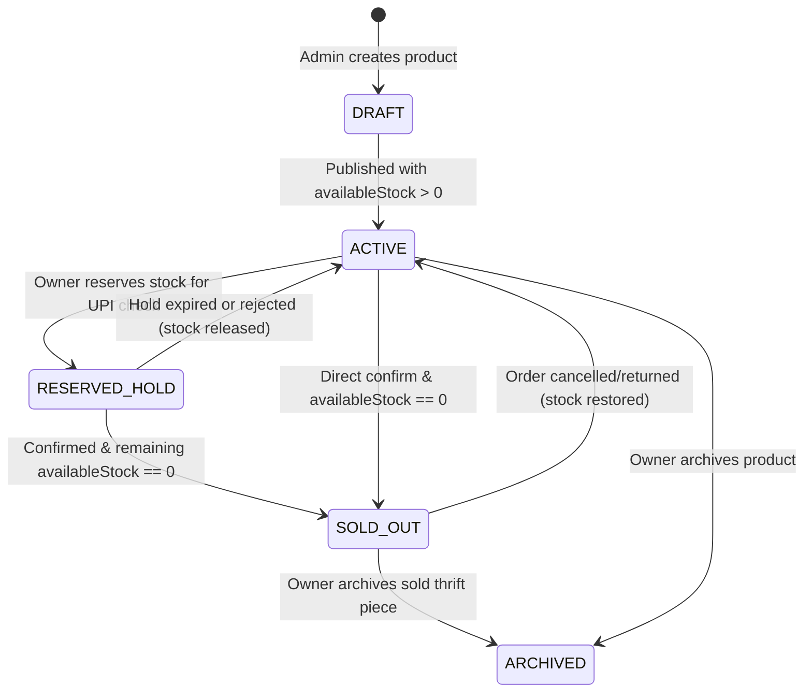

---

## 9. Cart & WhatsApp Checkout System

### 9.1 Cart Lifecycle & Guest-to-Customer Merge
1. **Cart Persistence:** Both Guests (assigned an `HttpOnly` signed `cu_guest_id` / header UUID with 14-day TTL) and logged-in Customers persist carts in `carts`. Every new active cart receives a human-readable unique **`cartCode`** (`CART-YYYYMMDD-XXXXXX`).
2. **Add/Update Guards:**
   - Rejects `productType === 'RENTAL'` (`400 USE_RENTAL_BOOKING_FLOW`).
   - Clamps `quantity` to `1` for `inventoryMode === 'SINGLE_UNIT'` (`409 SINGLE_UNIT_LIMIT`).
   - Validates `availableStock >= requestedQuantity` against live `products`.
3. **Cart Merge on Login:** `POST /api/v1/cart/merge` moves items from the guest cart into the authenticated user's cart (summing multi-unit quantities capped at `availableStock`, deduplicating `SINGLE_UNIT` items to qty `1`), marks guest cart `'MERGED'`, and returns unified cart totals.

### 9.2 Pre-Persisted WhatsApp Checkout Workflow
**Critical Invariant:** Redirecting to `https://wa.me/...` does **NOT** confirm an order or assume message delivery.

1. **Review & Validation (`POST /api/v1/checkout/requests`):**
   - Loads active cart + optional coupon + delivery address.
   - Re-validates live prices, product status (`ACTIVE`), and `availableStock >= qty`. If any item went out of stock or price changed since adding to cart, returns `409 CART_DISCREPANCY` with itemized warnings so the UI refreshes cleanly.
   - Generates unique **`requestCode`** (`CHK-YYYYMMDD-XXXX`).
   - Formats a clean URL-encoded WhatsApp summary containing `requestCode`, `cartCode`, item SKUs/sizes/quantities, subtotal, shipping, grand total, and customer delivery details.
   - Persists `CheckoutRequest` (`status: 'INITIATED'`) and creates an `ADMIN_NEW_CHECKOUT` notification **before** returning `{ requestCode, whatsappDeepLink, whatsappMessageText }` to React.
2. **Client Redirection & Resilience:**
   - Frontend opens `whatsappDeepLink` in a new tab AND renders a persistent **"Checkout Request Saved (`CHK-...`)"** confirmation screen with a **"Copy Order Message"** / **"Re-open WhatsApp"** fallback in case popup blockers or mobile app switches interrupt redirection!
3. **Owner Verification & Conversion:**
   - Owner opens **Owner CRM -> Checkout Requests**.
   - **Competing Requests Protection:** If multiple `INITIATED` requests reference the same `SINGLE_UNIT` variant, Owner CRM displays a `"Competing Requests (N)"` warning badge.
   - Owner can either:
     - **Reserve (`RESERVED_AWAITING_PAYMENT`)**: Atomically moves `availableStock -> reservedStock` with `reservationExpiresAt = now + 24h` while waiting for customer UPI transfer. (Auto-released by Cron Job if unpaid after 24h!).
     - **Confirm (`CONVERTED_TO_ORDER`)**: Atomically deducts stock, creates `Order` + `OrderItem`s + `InventoryLog` + `AuditLog`, clears Customer's active cart, notifies Customer (`ORDER_CONFIRMED`), and auto-flags rival pending requests for that sold-out SKU.
     - **Reject (`REJECTED`)**: Releases reservation (if held), logs reason, notifies customer.

### 9.3 Checkout Request Lifecycle Diagram

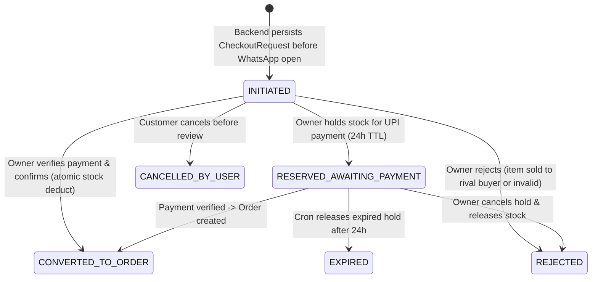

---

## 10. Rental Management System

### 10.1 Isolation & Pricing Mechanics
Rentals live exclusively in `rentals`, `rentalTransactions`, and `rentalDateLocks`:
- **Pricing Breakdown:**
  - `rentalCharge`: Calculated from `packages` matching `durationDays`, or `durationDays * baseChargePerDay`.
  - `securityDeposit`: Refundable collateral captured alongside rental charge prior to dispatch.
  - `totalInitialPayable = rentalCharge + securityDeposit`.
  - `lateFeePerDay` & `turnaroundBufferDays` (default `2` days for dry-cleaning/inspection/transit) snapshotted onto `rentals` at request time.

### 10.2 Date-Based Availability Algorithm & Conflict Prevention
All dates are normalized to calendar day strings `YYYY-MM-DD` in store timezone (`Asia/Kolkata`, stored as UTC midnight `00:00:00.000Z`).

1. **Effective Blocked Range:** A booking for `[startDate, endDate]` requires unit availability across:
   $$[\text{startDate},\ \text{endDate} + \text{turnaroundBufferDays}]$$
   (i.e. `effectiveBlockedUntil`).
2. **Read-Path Calendar Availability (`GET /api/v1/rentals/availability/:productId`):**
   - Queries `rentalDateLocks` for `{ productId, variantId, dateKey: { $gte: monthStart, $lte: monthEnd } }`.
   - Groups locks by `dateKey`: a date is **Unavailable** when `lockedUnitsCount >= product.rentalConfig.totalRentalUnits`.
   - When a customer selects `[reqStart, reqEnd]`, backend checks every day `d` from `reqStart` to `reqEnd + bufferDays` to ensure at least one `unitIndex` (`0 .. totalUnits - 1`) is completely free across the entire contiguous span!
3. **Write-Path Double-Booking Prevention (On Owner Approval inside ACID Transaction):**
   - **Step 1:** Inside `runInTransaction()`, fetch all `rentalDateLocks` overlapping `[startDate, effectiveBlockedUntil]` for `(productId, variantId)`.
   - **Step 2:** Find the lowest `unitIndex` in `0 .. totalRentalUnits - 1` that has **zero** locked `dateKey` rows in `[startDate, effectiveBlockedUntil]`. If none exist, abort transaction and throw `409 RENTAL_DATES_UNAVAILABLE`.
   - **Step 3:** Generate `dateKey` array covering `[startDate .. endDate]` (`lockKind: 'RENTAL_DAY'`) and `[endDate+1 .. effectiveBlockedUntil]` (`lockKind: 'TURNAROUND_BUFFER'`).
   - **Step 4:** `RentalDateLock.insertMany(locks, { session })`. Because `{ productId, variantId, unitIndex, dateKey }` has a **MongoDB Unique Index**, even two simultaneous admin approvals executing in parallel will collide at the database constraint layer (`E11000` / `WriteConflict`), making overlapping bookings physically impossible!
   - **Step 5:** Update `Rental` (`status: 'APPROVED'`, `unitIndex`) and write `AuditLog` + Customer `Notification`.

### 10.3 Rental Status Lifecycle Diagram

```mermaid
stateDiagram-v2
    [*] --> REQUESTED : Customer submits date range request
    REQUESTED --> APPROVED : Owner approves & inserts rentalDateLocks
    REQUESTED --> REJECTED : Owner declines request
    REQUESTED --> CANCELLED : Customer cancels prior to approval
    APPROVED --> DEPOSIT_PAID : Owner records Rental Fee + Deposit in ledger
    APPROVED --> CANCELLED : Unpaid / cancelled (deletes rentalDateLocks)
    DEPOSIT_PAID --> DISPATCHED : Item handed to courier / pickup
    DISPATCHED --> ACTIVE : Delivery confirmed (rental clock running)
    ACTIVE --> EXTENDED : Owner approves extension (adds new rentalDateLocks)
    ACTIVE --> OVERDUE : Cron marks past endDate without return
    EXTENDED --> OVERDUE : Cron marks past extended endDate
    ACTIVE --> RETURNED_INSPECTING : Garment received back at studio
    OVERDUE --> RETURNED_INSPECTING : Late garment received back at studio
    RETURNED_INSPECTING --> COMPLETED : Inspection done; fees deducted; deposit refunded
```

### 10.4 Return Inspection, Late Fees & Deposit Reconciliation
1. **Late Fee Calculation (`PATCH /api/v1/admin/rentals/:rentalId/status` with `status: 'RETURNED_INSPECTING'`):**
   - `lateDays = Math.max(0, calendarDaysBetween(rental.endDate, actualReturnDate))`.
   - `lateFeeCharged = lateDays * rental.pricingSnapshot.lateFeePerDay`.
2. **Damage Assessment & Deposit Settlement (`POST /api/v1/admin/rentals/:rentalId/settle`):**
   - Owner enters `damageFeeCharged` (with inspection notes/photos).
   - `totalDeductions = lateFeeCharged + damageFeeCharged`.
   - `depositRefundableAmount = Math.max(0, securityDeposit - totalDeductions)`.
   - `excessOwedByCustomer = Math.max(0, totalDeductions - securityDeposit)` (flagged for off-platform recovery if damage exceeds deposit).
   - Inside an ACID transaction: inserts immutable `rentalTransactions` rows (`LATE_FEE_ASSESSED`, `DAMAGE_FEE_ASSESSED`, `DEPOSIT_REFUNDED` / `DEPOSIT_FORFEITED`), removes any remaining future `rentalDateLocks` if returned early (keeping cleaning buffer days intact), sets status `COMPLETED`, and notifies customer with an itemized settlement receipt.

---

## 11. Order Management System

### 11.1 Order Creation & Immutability Guarantees
- Orders are created solely via transaction upon CheckoutRequest confirmation (`OrderService.confirmFromCheckout`) or future Razorpay webhook verification.
- Every order captures immutable `customerSnapshot`, `deliveryAddressSnapshot`, and `orderItems[].productSnapshot` so later price updates, product archival, or customer address edits never rewrite historical invoices.

### 11.2 Order Status Machine & Permitted Transitions

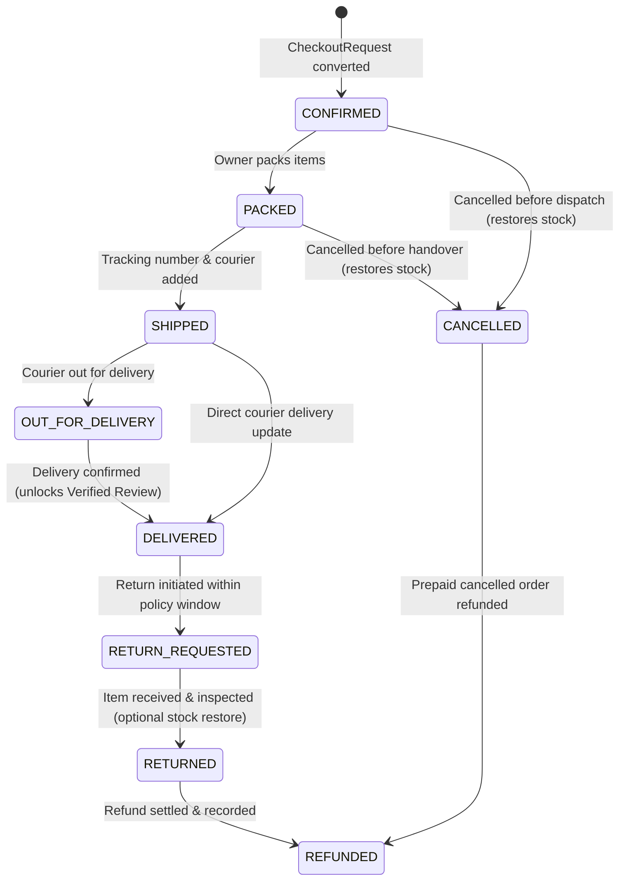

| Current Status | Permitted Next Statuses | Side Effects Enforced in Service |
| :--- | :--- | :--- |
| `CONFIRMED` | `PACKED`, `CANCELLED` | `CANCELLED` atomically restores `orderItems` qty to `products` & inserts `RESTORE_CANCEL` in `inventoryLogs`. |
| `PACKED` | `SHIPPED`, `CANCELLED` | `SHIPPED` requires `trackingInfo.carrier` + `trackingNumber`. |
| `SHIPPED` | `OUT_FOR_DELIVERY`, `DELIVERED` | `DELIVERED` sets `deliveredAt`, syncs `orderItems.orderFulfillmentStatus = 'DELIVERED'` (enabling Verified Reviews!). |
| `OUT_FOR_DELIVERY` | `DELIVERED` | Same as above. |
| `DELIVERED` | `RETURN_REQUESTED` | Validated against return window & `PRE_LOVED` return eligibility rules. |
| `RETURN_REQUESTED` | `RETURNED`, `DELIVERED` (rejected return) | `RETURNED` requires admin inspection flag `restockItem: boolean`; if true, restores `stock` & logs `RESTORE_RETURN`. |
| `RETURNED` / `CANCELLED` | `REFUNDED` | Records `refundRecord` (`amount`, `method`, `reference`, `processedAt`) & updates `paymentStatus`. |

---

## 12. Customer CRM Architecture

Every Customer CRM module retrieves data strictly scoped to `req.auth.id` (verified Customer JWT), stripping admin-only fields (`internalNotes`, `moderatedBy`, other users' handles/IPs).

| Customer CRM Module | Backend Data Sources | Core Operations & Ownership Enforcement |
| :--- | :--- | :--- |
| **Profile** | `users` | `GET /users/me`, `PATCH /users/me` (name, phone, avatar), `PATCH /users/me/password` (verifies current bcrypt hash, increments `tokenVersion`). |
| **Addresses** | `users.addresses[]` | Embedded subdoc CRUD (`POST`, `PATCH`, `DELETE`, `PATCH /:id/default`); enforces `addresses.length <= 10`. |
| **Orders & Tracking** | `orders`, `orderItems`, `checkoutRequests` | `GET /orders` (filter by `status`), `GET /orders/:id` (`{ _id, userId: req.auth.id }`) returns order, line items, timeline & courier tracking; hides `internalNotes`. |
| **Rentals & Deposits** | `rentals`, `rentalTransactions` | `GET /rentals/my`, `GET /rentals/my/:id` returns booking dates, countdown to return, `chargesSummary`, and itemized `rentalTransactions` deposit ledger. |
| **Wishlist** | `wishlists` joined with `products` | `GET /wishlist` hydrates live `price`, `availableStock`, and `status` (`SOLD_OUT` badges); `POST/DELETE /wishlist/:productId`. |
| **Cart** | `carts` joined with `products` | `GET /cart`, `POST /cart/items`, `PATCH /cart/items/:sku`, `DELETE /cart/items/:sku` (re-validates stock on every read/write). |
| **Notifications** | `notifications` | `GET /notifications` (`recipientType: 'CUSTOMER', recipientId: req.auth.id`), unread counter, mark read / mark all read. |
| **Reviews** | `reviews`, `orderItems`, `rentals` | Lists user's submitted reviews + unreviewed delivered `orderItems` / completed `rentals` eligible for Verified Purchase reviews. |
| **Community** | `eventRegistrations` + `events`, `communityPosts` | Shows upcoming/past event tickets (`registrationCode`), allows event cancellation before deadline, displays `#ThriftCrew` submission moderation status (`PENDING`/`APPROVED`/`REJECTED`). |
| **Support** | `siteContent` (`CONTACT_INFO`), `orders` / `rentals` | Provides pre-filled order/rental-linked WhatsApp support links + contact form submission (`POST /content/contact-enquiry` emailing Owner). |

---

## 13. Owner CRM Architecture

All Owner CRM endpoints sit under `/api/v1/admin/*`, require `actorType === 'ADMIN'` + `role in ['OWNER', 'STAFF']` + active `permissions` check, and record `auditLogs` on every mutation.

### 13.1 Dashboard & Analytics Aggregations (Recharts)
- **KPI Summary (`GET /api/v1/admin/analytics/overview?from=&to=`):** Executes parallel MongoDB queries/aggregations:
  - **Total Sales Revenue:** `$match` `orders` (`paymentStatus: 'PAID'`, `status: { $nin: ['CANCELLED', 'REFUNDED'] }`) -> `$sum: '$grandTotal'`.
  - **Rental Revenue:** `$match` `rentalTransactions` (`type: { $in: ['RENTAL_FEE_PAID', 'LATE_FEE_ASSESSED', 'DAMAGE_FEE_ASSESSED'] }`) -> `$sum: '$amount'`.
  - **Pending Checkout Requests:** `checkoutRequests.countDocuments({ status: { $in: ['INITIATED', 'RESERVED_AWAITING_PAYMENT'] } })`.
  - **Customers / Active & Out-of-Stock Products:** Indexed counts on `users` and `products`.
  - **Active Rentals & Due/Overdue Rentals:** `rentals.countDocuments({ status: { $in: ['DISPATCHED', 'ACTIVE', 'EXTENDED'] } })` + `rentals.countDocuments({ status: 'OVERDUE' })` + due within 48h.
- **Recharts Time-Series (`GET /api/v1/admin/analytics/sales-chart?granularity=day|week|month`):** `$dateTrunc` / `$dateToString` (timezone `'Asia/Kolkata'`) over `orders` + `rentalTransactions` returning contiguous zero-filled series for `<AreaChart>` / `<BarChart>`.
- **Bestselling Products & Category Mix:** Aggregates `orderItems` (`itemStatus: 'ACTIVE'`) grouped by `productId` and `categoryId` sorted by `unitsSold` & `revenue`.

### 13.2 Operational CRM Modules
- **Product & Category CRUD:** Full multi-variant management, SKU uniqueness validation, Cloudinary image cleanup on removal, soft-archival (`ARCHIVED`) preserving order/review integrity.
- **Inventory Console:** Filterable view of `SINGLE_UNIT` items, `lowStock <= threshold` multi-unit variants, manual adjustments (`MANUAL_ADJUST` writing `inventoryLogs`), and full movement history.
- **Checkout Request Queue:** Live queue sorted oldest-first, surfacing competing requests on identical `SINGLE_UNIT` SKUs, with atomic `Reserve`, `Confirm Order`, and `Reject` actions.
- **Order & Rental Consoles:** State-machine validated transitions, courier tracking input, deposit collection/refund ledger forms, and rental availability calendar viewer.
- **Customer & Content Consoles:** Customer search (`email`/`phone`/`name`), suspension (`status: 'SUSPENDED'` + revoking all `authSessions`), CMS editor (`siteContent`), and read-only `AuditLog` explorer (Owner only).

---

## 14. Community System (Reviews, Events & `#ThriftCrew`)

1. **Reviews & Verified Purchase Enforcement:**
   - Anyone logged in can submit a store/product review (`PENDING` moderation by default unless auto-publish policy enabled by Owner).
   - Server ignores any client `isVerifiedPurchase` field; instead, `ReviewService` queries `orderItems` (`{ userId, productId, orderFulfillmentStatus: 'DELIVERED' }`) or `rentals` (`{ userId, productId, status: 'COMPLETED' }`). Only if a matching record exists does the backend set `isVerifiedPurchase = true` and attach `orderItemId` / `rentalId`.
   - When Owner approves/deletes a product review, `ReviewService` recalculates `products.ratingAvg` and `products.ratingCount` atomically.
2. **Events / *The Social Circle*:**
   - **Atomic Capacity Guard:** On `POST /api/v1/events/:id/register`, inside a MongoDB transaction:
     `Event.findOneAndUpdate({ _id: eventId, status: 'PUBLISHED', registrationDeadline: { $gt: now }, $expr: { $lt: ['$registeredCount', '$capacity'] } }, { $inc: { registeredCount: 1 } })`.
   - Inserts `eventRegistrations` (unique `(eventId, userId)` active index prevents double-booking) and triggers `EVENT_REGISTERED` notification + email ticket.
   - Cancellation before deadline atomically decrements `registeredCount`.
3. **`#ThriftCrew` Submissions & Consent Governance:**
   - **Pre-Publish Gate:** Newly created `communityPosts` ALWAYS default to `moderationStatus: 'PENDING'` and `publishedAt: null`. Public `GET /api/v1/community/posts` hardcodes `{ moderationStatus: 'APPROVED' }`.
   - **Mandatory Image Consent:** Submission form requires an explicit unchecked-by-default checkbox acknowledging CircleUp's community media license. Backend requires `consentGranted === true` and persists `{ granted: true, policyVersion: 'v1.0-2026', consentedAt: new Date(), ipAddress: req.ip, allowSocialRepost }` so legal proof of photo consent is permanently auditable.

---

## 15. Complete REST API Specification

### 15.1 Standard Conventions, Envelopes & Pagination
- **Base Path:** `/api/v1`
- **Success Envelope:**
  ```json
  {
    "success": true,
    "message": "Optional human-readable summary",
    "data": {},
    "meta": { "page": 1, "limit": 20, "total": 142, "totalPages": 8, "hasNext": true }
  }
  ```
- **Error Envelope:**
  ```json
  {
    "success": false,
    "error": {
      "code": "INSUFFICIENT_STOCK",
      "message": "Vintage Levi's Denim Jacket is no longer available.",
      "details": [{ "field": "items[0]", "issue": "Only 0 units left" }],
      "requestId": "req-91d4f20a"
    }
  }
  ```
- **Pagination, Filtering, Sorting & Search:**
  - All collection list endpoints enforce `?page=1&limit=20` (max `limit=100`). Large unbounded arrays are forbidden.
  - Products support `?productType=&category=&size=&condition=&minPrice=&maxPrice=&inStock=true&q=&sort=newest|price_asc|price_desc|bestselling`.
  - Text search uses MongoDB `$text` index (`{ $text: { $search: q } }`) combined with sanitized regex fallback for partial SKU/brand matching on admin tables (`escapeRegex(q)`).

### 15.2 Auth & Uploads & System Health Endpoints

| Method | Endpoint | Purpose | Auth / Role | Request / Query | Response (`data`) & Errors |
| :--- | :--- | :--- | :--- | :--- | :--- |
| `GET` | `/health` | Readiness check (API + Mongo ping) | Public | None | `200`: `{ status: 'ok', db: 'connected', uptime }`; `503` if DB down |
| `POST` | `/uploads/signature` | Generate signed Cloudinary upload params | Auth (`CUSTOMER`/`OWNER`/`STAFF`) | Body: `{ folder: 'products' \| 'community' \| 'reviews' \| 'cms', count }` | `200`: `{ signature, timestamp, cloudName, apiKey, folder, maxFileBytes }`; `403` if customer requests `products`/`cms` folder! |
| `POST` | `/auth/register` | Register new customer account | Public | Body: `{ fullName, email, phone?, password }` | `201`: `{ user, accessToken }` + sets `HttpOnly` refresh cookie; `409 EMAIL_EXISTS` |
| `POST` | `/auth/login` | Customer login | Public | Body: `{ email, password }` | `200`: `{ user, accessToken }` + refresh cookie; `401 INVALID_CREDENTIALS`, `423 ACCOUNT_LOCKED` |
| `POST` | `/auth/refresh` | Rotate customer refresh cookie -> new access JWT | Refresh Cookie | Cookie: `cu_refresh_token` | `200`: `{ accessToken, user }`; `401 SESSION_INVALID_OR_REUSED` |
| `POST` | `/auth/logout` | Revoke current customer session | Customer / Cookie | Cookie: `cu_refresh_token` | `200`: `{ loggedOut: true }` + clears cookie |
| `POST` | `/auth/logout-all` | Revoke all customer devices | Customer | None | `200`: `{ revokedSessions: N }` |
| `POST` | `/auth/verify-email` | Verify email token | Public | Body: `{ token }` | `200`: `{ verified: true }`; `400 INVALID_OR_EXPIRED_TOKEN` |
| `POST` | `/auth/resend-verification` | Resend email verification link | Customer | None | `200`: `{ sent: true }`; `429 RATE_LIMITED` |
| `POST` | `/auth/forgot-password` | Request password reset email | Public | Body: `{ email }` | `200`: Generic success (never discloses email existence) |
| `POST` | `/auth/reset-password` | Reset password with token | Public | Body: `{ token, newPassword }` | `200`: `{ reset: true }`; `400 INVALID_OR_EXPIRED_TOKEN` |
| `POST` | `/admin/auth/login` | Isolated Admin login (`OWNER`/`STAFF`) | Public | Body: `{ email, password }` | `200`: `{ admin, accessToken }` + `cu_admin_refresh` cookie; `401`, `423` |
| `POST` | `/admin/auth/refresh` | Rotate admin refresh cookie | Admin Refresh Cookie | Cookie: `cu_admin_refresh` | `200`: `{ accessToken, admin }`; `401` |
| `POST` | `/admin/auth/logout` | Revoke admin session | Admin | Cookie: `cu_admin_refresh` | `200`: `{ loggedOut: true }` |

### 15.3 Users (Customer CRM) Endpoints

| Method | Endpoint | Purpose | Auth / Role | Request / Query | Response & Errors |
| :--- | :--- | :--- | :--- | :--- | :--- |
| `GET` | `/users/me` | Fetch own profile & addresses | Customer | None | `200`: `{ user }` (excludes sensitive hashes) |
| `PATCH` | `/users/me` | Update name, phone, avatar | Customer | Body: `{ fullName?, phone?, avatar? }` | `200`: `{ user }`; `409 PHONE_IN_USE` |
| `PATCH` | `/users/me/password` | Change password | Customer | Body: `{ currentPassword, newPassword }` | `200`: `{ updated: true }`; `401 WRONG_PASSWORD` |
| `POST` | `/users/me/addresses` | Add delivery address (max 10) | Customer | Body: `{ label, recipientName, phone, line1, line2?, city, state, postalCode, isDefault? }` | `201`: `{ addresses }`; `422 MAX_ADDRESSES_REACHED` |
| `PATCH` | `/users/me/addresses/:addressId` | Update saved address | Customer (Own) | Body: partial address fields | `200`: `{ addresses }`; `404 ADDRESS_NOT_FOUND` |
| `DELETE` | `/users/me/addresses/:addressId` | Remove saved address | Customer (Own) | None | `200`: `{ addresses }` |

### 15.4 Categories & Products Endpoints

| Method | Endpoint | Purpose | Auth / Role | Request / Query | Response & Errors |
| :--- | :--- | :--- | :--- | :--- | :--- |
| `GET` | `/categories` | List active category tree | Public | Query: `?parentOnly=true` | `200`: `{ categories[] }` |
| `POST` | `/admin/categories` | Create category/subcategory | `OWNER` / `STAFF` | Body: `{ name, slug?, parentId?, description?, image?, displayOrder? }` | `201`: `{ category }`; `409 SLUG_EXISTS` |
| `PATCH` | `/admin/categories/:id` | Update category | `OWNER` / `STAFF` | Body: partial category | `200`: `{ category }` |
| `DELETE` | `/admin/categories/:id` | Deactivate/delete unused category | `OWNER` / `STAFF` | None | `200`; `409 CATEGORY_HAS_PRODUCTS` |
| `GET` | `/products` | Filter, search & paginate active catalog | Public | Query: `?page&limit&category&productType&size&condition&minPrice&maxPrice&inStock&tag&isNewArrival&q&sort` | `200`: `{ products[], meta }` |
| `GET` | `/products/:slug` | Single product details + active variants + review stats | Public | None | `200`: `{ product, relatedProducts[] }`; `404` |
| `GET` | `/admin/products` | List all products (incl. `DRAFT`/`ARCHIVED`) | `OWNER` / `STAFF` | Query: `?page&limit&status&productType&q` | `200`: `{ products[], meta }` |
| `POST` | `/admin/products` | Create product (`PRE_LOVED`/`FRESH_FINDS`/`RENTAL`/`HANDCRAFTED`) | `OWNER` / `STAFF` | Body: full product + variants + optional `rentalConfig` | `201`: `{ product }` + writes `INITIAL_STOCK` log; `400 VALIDATION_ERROR`, `409 SKU_EXISTS` |
| `PATCH` | `/admin/products/:id` | Update metadata, pricing, images, status | `OWNER` / `STAFF` | Body: partial product | `200`: `{ product }` + `AuditLog` |
| `DELETE` | `/admin/products/:id` | Soft-archive product (`status='ARCHIVED'`) | `OWNER` / `STAFF` | None | `200`: `{ archived: true }` (preserves order history!) |

### 15.5 Inventory Endpoints (Owner CRM)

| Method | Endpoint | Purpose | Auth / Role | Request / Query | Response & Errors |
| :--- | :--- | :--- | :--- | :--- | :--- |
| `GET` | `/admin/inventory` | View stock matrix across all variants | `OWNER` / `STAFF` | Query: `?page&limit&lowStockOnly&inventoryMode&q` | `200`: `{ variants[], meta }` |
| `POST` | `/admin/inventory/adjust` | Manual stock adjustment (+ / -) | `OWNER` / `STAFF` | Body: `{ productId, variantId, delta, reason }` | `200`: `{ variant, log }`; `409 NEGATIVE_STOCK_FORBIDDEN` or `SINGLE_UNIT_MAX_1` |
| `GET` | `/admin/inventory/logs` | Paginated inventory movement history | `OWNER` / `STAFF` | Query: `?page&limit&productId&sku&action&from&to` | `200`: `{ logs[], meta }` |

### 15.6 Cart & Checkout Endpoints

| Method | Endpoint | Purpose | Auth / Role | Request / Query | Response & Errors |
| :--- | :--- | :--- | :--- | :--- | :--- |
| `GET` | `/cart` | Fetch/create active cart with live price & stock flags | Public (Guest/Customer) | Header/Cookie: `x-guest-cart-id` or JWT | `200`: `{ cartCode, items[], summary, warnings[] }` |
| `POST` | `/cart/items` | Add item to cart | Public (Guest/Customer) | Body: `{ productId, variantId, quantity }` | `200`: `{ cart }`; `400 RENTAL_NOT_ALLOWED`, `409 INSUFFICIENT_STOCK` |
| `PATCH` | `/cart/items/:variantId` | Update item quantity | Public (Guest/Customer) | Body: `{ quantity }` | `200`: `{ cart }`; `409` |
| `DELETE` | `/cart/items/:variantId` | Remove cart item | Public (Guest/Customer) | None | `200`: `{ cart }` |
| `POST` | `/cart/coupon` | Preview & attach coupon code | Customer | Body: `{ code }` | `200`: `{ cart, discountPreview }`; `400 INVALID_OR_EXPIRED_COUPON` |
| `POST` | `/cart/merge` | Merge guest cart into logged-in user cart | Customer | Body: `{ guestSessionId }` | `200`: `{ cart, mergedWarnings[] }` |
| `POST` | `/checkout/requests` | Validate cart, persist `CheckoutRequest`, generate WhatsApp link | Customer (or Guest if enabled) | Body: `{ addressId?, guestAddress?, customerSnapshot?, customerNotes?, couponCode? }` | `201`: `{ requestCode, cartCode, grandTotal, whatsappMessageText, whatsappDeepLink }`; `409 CART_DISCREPANCY` |
| `GET` | `/checkout/requests/my` | Customer's own checkout requests | Customer | Query: `?page&limit` | `200`: `{ requests[], meta }` |
| `POST` | `/checkout/requests/:id/cancel` | Cancel own `INITIATED` checkout request | Customer (Own) | None | `200`: `{ request }`; `409 ALREADY_CONVERTED` |
| `GET` | `/admin/checkout-requests` | Queue of WhatsApp checkout enquiries + competing flags | `OWNER` / `STAFF` | Query: `?page&limit&status&q` | `200`: `{ requests[], meta }` |
| `POST` | `/admin/checkout-requests/:id/reserve` | Hold inventory (24h TTL) while awaiting UPI payment | `OWNER` / `STAFF` | Body: `{ holdHours?: 24 }` | `200`: `{ request }`; `409 INSUFFICIENT_STOCK` |
| `POST` | `/admin/checkout-requests/:id/confirm` | Atomically deduct stock, create Order & OrderItems, clear cart | `OWNER` / `STAFF` | Body: `{ paymentMethod, paymentStatus, paymentReference?, internalNotes? }` | `201`: `{ order, request }`; `409 INSUFFICIENT_STOCK` |
| `POST` | `/admin/checkout-requests/:id/reject` | Reject enquiry & release any reservation | `OWNER` / `STAFF` | Body: `{ reason }` | `200`: `{ request }` |

### 15.7 Orders Endpoints

| Method | Endpoint | Purpose | Auth / Role | Request / Query | Response & Errors |
| :--- | :--- | :--- | :--- | :--- | :--- |
| `GET` | `/orders/my` | Customer order history | Customer | Query: `?page&limit&status` | `200`: `{ orders[], meta }` |
| `GET` | `/orders/my/:orderId` | Order detail + items + tracking (no `internalNotes`) | Customer (Own) | None | `200`: `{ order, items[] }`; `404` |
| `POST` | `/orders/my/:orderId/return-request` | Request return for delivered order | Customer (Own) | Body: `{ reason, itemIds[] }` | `200`: `{ order }`; `400 RETURN_WINDOW_CLOSED` |
| `GET` | `/admin/orders` | List all orders with filters | `OWNER` / `STAFF` | Query: `?page&limit&status&paymentStatus&q&from&to` | `200`: `{ orders[], meta }` |
| `GET` | `/admin/orders/:orderId` | Full admin order details incl. `internalNotes` | `OWNER` / `STAFF` | None | `200`: `{ order, items[] }` |
| `PATCH` | `/admin/orders/:orderId/status` | Transition status (`PACKED`, `SHIPPED`, `DELIVERED`, etc.) | `OWNER` / `STAFF` | Body: `{ status, note?, trackingInfo? }` | `200`: `{ order }`; `400 INVALID_TRANSITION` |
| `POST` | `/admin/orders/:orderId/cancel` | Cancel order & atomically restore inventory | `OWNER` / `STAFF` | Body: `{ reason, restock: true }` | `200`: `{ order }` |
| `POST` | `/admin/orders/:orderId/refund` | Record refund settlement & optional return restock | `OWNER` / `STAFF` | Body: `{ amount, method, reference, reason, restockItems?: boolean }` | `200`: `{ order }`; `422 EXCEEDS_ORDER_TOTAL` |

### 15.8 Rentals Endpoints

| Method | Endpoint | Purpose | Auth / Role | Request / Query | Response & Errors |
| :--- | :--- | :--- | :--- | :--- | :--- |
| `GET` | `/rentals/availability/:productId` | Fetch blocked dates & price quote for calendar | Public | Query: `?variantId&from=YYYY-MM-DD&to=YYYY-MM-DD` | `200`: `{ unavailableDates[], turnaroundBufferDays, quote? }` |
| `POST` | `/rentals/requests` | Submit rental booking request | Customer (Verified) | Body: `{ productId, variantId, startDate, endDate, addressId, customerNotes? }` | `201`: `{ rental, whatsappDeepLink }`; `409 RENTAL_DATES_UNAVAILABLE` |
| `GET` | `/rentals/my` | Customer's rental history & active due dates | Customer | Query: `?page&limit&status` | `200`: `{ rentals[], meta }` |
| `GET` | `/rentals/my/:rentalId` | Customer rental details + deposit transaction ledger | Customer (Own) | None | `200`: `{ rental, transactions[] }`; `404` |
| `POST` | `/rentals/my/:rentalId/cancel` | Cancel `REQUESTED` booking prior to approval | Customer (Own) | None | `200`: `{ rental }`; `409 CANNOT_CANCEL_ACTIVE` |
| `GET` | `/admin/rentals` | List rental requests, active & overdue bookings | `OWNER` / `STAFF` | Query: `?page&limit&status&dueSoon=true&q` | `200`: `{ rentals[], meta }` |
| `POST` | `/admin/rentals/:rentalId/approve` | Atomically lock calendar dates (`rentalDateLocks`) & approve | `OWNER` / `STAFF` | Body: `{ notes? }` | `200`: `{ rental }`; `409 OVERLAPPING_BOOKING_CONFLICT` |
| `POST` | `/admin/rentals/:rentalId/reject` | Decline rental request | `OWNER` / `STAFF` | Body: `{ reason }` | `200`: `{ rental }` |
| `POST` | `/admin/rentals/:rentalId/transactions` | Record Rental Charge / Security Deposit payment | `OWNER` / `STAFF` | Body: `{ type, amount, paymentMethod, reference?, notes? }` | `201`: `{ transaction, rental }` |
| `PATCH` | `/admin/rentals/:rentalId/status` | Transition `DISPATCHED` -> `ACTIVE` -> `RETURNED_INSPECTING` | `OWNER` / `STAFF` | Body: `{ status, actualReturnDate?, inspectionNotes? }` | `200`: `{ rental }` |
| `POST` | `/admin/rentals/:rentalId/extend` | Extend active rental endDate (checks & inserts new date locks) | `OWNER` / `STAFF` | Body: `{ newEndDate, additionalCharge }` | `200`: `{ rental }`; `409 EXTENSION_CONFLICT` |
| `POST` | `/admin/rentals/:rentalId/settle` | Finalize late/damage fees, refund/forfeit deposit, complete rental | `OWNER` / `STAFF` | Body: `{ damageFeeCharged, refundMethod, refundReference?, notes }` | `200`: `{ rental, transactions[] }` |

### 15.9 Wishlist, Reviews, Events, Community, Notifications, Content, Admin & Analytics

| Domain | Method & Path | Purpose | Auth / Role | Key Body / Query & Responses |
| :--- | :--- | :--- | :--- | :--- |
| **Wishlist** | `GET /wishlist` | Paginated saved items with live stock | Customer | `?page&limit` -> `200 { items[], meta }` |
| **Wishlist** | `POST /wishlist/:productId` | Add product to wishlist | Customer | Body `{ variantId? }` -> `201` (idempotent) |
| **Wishlist** | `DELETE /wishlist/:productId` | Remove from wishlist | Customer | `200` |
| **Reviews** | `GET /reviews` | Approved reviews (storewide or by `?productId=`) | Public | `?page&limit&productId&rating` -> `200 { reviews[], meta }` |
| **Reviews** | `GET /reviews/my` | Own reviews + eligible unreviewed items | Customer | `200 { submitted[], eligibleItems[] }` |
| **Reviews** | `POST /reviews` | Submit review (server verifies purchase/rental!) | Customer | Body `{ targetType, productId?, rating, title?, comment, images? }` -> `201` (`PENDING`) |
| **Reviews** | `PATCH /admin/reviews/:id/moderate` | Approve/Reject & optional admin reply | `OWNER` / `STAFF` | Body `{ moderationStatus, adminReply? }` -> `200` (updates `products.ratingAvg`) |
| **Events** | `GET /events` | List published events (`The Social Circle`) | Public | `?page&limit&upcoming=true` -> `200 { events[], meta }` |
| **Events** | `GET /events/:slug` | Event details & remaining spots | Public | `200 { event }` |
| **Events** | `POST /events/:id/register` | Register for event (atomic capacity guard) | Customer | Body `{ notes? }` -> `201 { registration }`; `409 EVENT_FULL` or `ALREADY_REGISTERED` |
| **Events** | `DELETE /events/:id/register` | Cancel own event registration | Customer | `200` (decrements `registeredCount`) |
| **Events** | `POST /admin/events` / `PATCH /admin/events/:id` | Create/update event | `OWNER` / `STAFF` | Full event payload -> `201`/`200` |
| **Events** | `GET /admin/events/:id/registrations` | View attendee roster & mark attendance | `OWNER` / `STAFF` | `?page&limit&status` -> `200 { registrations[], meta }` |
| **Community** | `GET /community/posts` | Public `#ThriftCrew` feed (strictly `APPROVED` only) | Public | `?page&limit&featured=true` -> `200 { posts[], meta }` |
| **Community** | `GET /community/posts/my` | Customer's own submissions & moderation state | Customer | `?page&limit` -> `200 { posts[], meta }` |
| **Community** | `POST /community/posts` | Submit `#ThriftCrew` post (requires explicit consent) | Customer | Body `{ authorHandle, caption, media[], taggedProductIds?, consentGranted: true, allowSocialRepost }` -> `201` (`PENDING`); `400 CONSENT_REQUIRED` |
| **Community** | `GET /admin/community/posts` | Moderation queue (`PENDING`/`APPROVED`/`REJECTED`) | `OWNER` / `STAFF` | `?page&limit&moderationStatus` -> `200` |
| **Community** | `PATCH /admin/community/posts/:id/moderate` | Approve/Reject/Feature community post | `OWNER` / `STAFF` | Body `{ moderationStatus, isFeatured?, rejectionReason? }` -> `200` + Customer notification |
| **Notifications** | `GET /notifications` | Fetch notifications & unread count (Customer or Admin) | Customer / Admin | `?page&limit&unreadOnly=true` -> `200 { notifications[], unreadCount, meta }` |
| **Notifications** | `PATCH /notifications/:id/read` / `PATCH /notifications/read-all` | Mark notification(s) read | Customer / Admin (Own) | `200` |
| **Content** | `GET /content/:key` | Fetch published CMS block (`HOME_HERO`, `ABOUT_US`, etc.) | Public | `200 { content }` |
| **Content** | `POST /content/contact-enquiry` | Submit public Contact Us form (rate limited) | Public | Body `{ name, email, phone?, subject, message }` -> `202` (emails Owner) |
| **Content** | `PUT /admin/content/:key` | Upsert CMS block / policy / operational config | `OWNER` / `STAFF` | Body `{ title, payload, isPublished }` -> `200` (increments `version`) |
| **Admin CRM** | `GET /admin/customers` / `GET /admin/customers/:id` | Search customers & view full profile/orders/rentals | `OWNER` / `STAFF` | `?page&limit&status&q` -> `200` |
| **Admin CRM** | `PATCH /admin/customers/:id/status` | Suspend or reactivate customer (revokes sessions) | `OWNER` | Body `{ status: 'ACTIVE' \| 'SUSPENDED', reason }` -> `200` |
| **Admin CRM** | `POST /admin/staff` / `PATCH /admin/staff/:id` | Create/manage future Staff accounts & permissions | `OWNER` Only | Body `{ fullName, email, password, permissions[] }` -> `201` |
| **Admin CRM** | `GET /admin/audit-logs` | Read-only security & operational audit trail | `OWNER` Only | `?page&limit&actorId&resourceType&action&from&to` -> `200` |
| **Analytics** | `GET /admin/analytics/overview` | Dashboard KPIs (Revenue, Orders, Rentals, Stock) | `OWNER` / `STAFF` | `?from&to` -> `200 { kpis }` |
| **Analytics** | `GET /admin/analytics/sales-chart` | Recharts daily/weekly/monthly sales & rental series | `OWNER` / `STAFF` | `?from&to&granularity` -> `200 { series[] }` |
| **Analytics** | `GET /admin/analytics/bestsellers` | Top selling products & categories | `OWNER` / `STAFF` | `?from&to&limit` -> `200 { topProducts[], byCategory[] }` |
| **Cron** | `POST /internal/jobs/:jobName` | Trigger scheduled job (`overdue-rentals`, `release-holds`) | Cron Secret Header | Header: `X-Cron-Secret` (constant-time compare) -> `200 { processedCount }` |

---

## 16. Security Architecture Review & Mitigations

| Threat / OWASP Category | Specific CircleUp Attack Vector | Concrete Technical Prevention Strategy |
| :--- | :--- | :--- |
| **NoSQL Injection** (A03) | Sending `{ "email": { "$ne": "" }, "password": ... }` or `$gt` in query filters. | 1. **Zod strict schema parsing** on every `body`/`query`/`params` rejects non-primitive types (`z.string().email()`).<br>2. Custom recursive `sanitize()` middleware strips any object keys starting with `$` or containing `.`.<br>3. `mongoose.set('sanitizeFilter', true)` enabled globally. |
| **XSS (Cross-Site Scripting)** (A03) | Malicious `<script>` or `javascript:` URLs in `#ThriftCrew` captions, product reviews, or CMS fields. | 1. React auto-escapes JSX by default; `dangerouslySetInnerHTML` is banned except sanitized CMS markdown via `DOMPurify` + strict allowlist.<br>2. `helmet()` sets Content-Security-Policy (`script-src 'self'`, `img-src 'self' https://res.cloudinary.com`).<br>3. Refresh tokens sit in `HttpOnly` cookies (inaccessible to `document.cookie`), and Access JWT stays in Redux memory (never `localStorage`). |
| **CSRF** (A01) | Cross-site hidden form triggering `/auth/refresh` or `/checkout/requests`. | 1. API state-changing endpoints require `Authorization: Bearer <token>` header (browsers never attach custom `Authorization` headers automatically from cross-origin forms).<br>2. Cookie-authenticated `/refresh` & `/logout` routes enforce `SameSite=Lax`, validate `Origin`/`Referer` against `CORS_ALLOWED_ORIGINS`, and require `X-Requested-With: CircleUpClient`. |
| **Broken Access Control & IDOR** (A01) | Customer A querying `GET /orders/my/<OrderB_Id>` or calling `/admin/*` with Customer JWT. | 1. `authenticate` validates `actorType` (`CUSTOMER` vs `ADMIN`); Customer tokens are rejected (`403`) on `/admin/*` before reaching controllers.<br>2. Every Customer CRM DB query includes `{ _id: id, userId: req.auth.id }` in the MongoDB filter.<br>3. Never trust client-supplied `price`, `role`, `isVerifiedPurchase`, or `moderationStatus`. |
| **Brute-Force & Credential Stuffing** (A07) | Automated login attempts against `/auth/login` or `/admin/auth/login`. | 1. `express-rate-limit` tiered windows: Auth Customer (`10 req / 15 min` per IP+email), Admin Login (`5 req / 15 min`), Forgot Password (`3 req / 15 min`).<br>2. DB account lockout (`failedLoginAttempts >= 5` -> 15-min lock).<br>3. `bcrypt` cost factor `12` (~250ms per hash). |
| **File Upload Vulnerabilities** (A04) | Uploading `.svg` XSS payloads, executables, or 50MB files. | 1. Backend `/uploads/signature` restricts Cloudinary `allowed_formats: ['jpg','jpeg','png','webp']` (`svg` blocked!) and `max_file_size: 5MB`.<br>2. Client validates MIME & dimensions pre-upload.<br>3. Backend rejects any `publicId` not beginning with the authorized Cloudinary folder prefix (`circleup/community/` for customers). |
| **API Abuse & Checkout Spam** (A04) | Bots flooding `POST /checkout/requests` or `POST /rentals/requests`. | 1. Per-user & per-IP rate limits (`5 checkout requests / 10 min`).<br>2. Maximum 3 open `INITIATED` checkout requests per customer.<br>3. Mandatory email verification before Rental requests & `#ThriftCrew` submissions. |
| **Sensitive Data Exposure** (A02) | Password hashes, reset tokens, `internalNotes`, or stack traces leaking in JSON responses. | 1. Mongoose `select: false` on `passwordHash` and token hashes.<br>2. Explicit projection/DTO serializers on every API response.<br>3. `pino` redacts `req.headers.authorization`, `req.headers.cookie`, `*.password`, `*.token`.<br>4. Production error handler suppresses stack traces. |
| **Secrets & Database Security** (A05) | Leaked `.env` or overly permissive Atlas access. | 1. Zod env validator verifies secret entropy (`JWT_SECRET >= 32 chars`).<br>2. MongoDB Atlas dedicated least-privilege DB user (`readWrite` on `circleup_prod` only — never Atlas Project Owner credentials!), TLS enforced, IP allowlisted to Render outbound static IPs (or VPC peering). |
| **Admin Account Protection** (A07) | Compromise of Owner CRM. | 1. Isolated `/api/v1/admin/auth/*` endpoints & separate `cu_admin_refresh` cookie (`12h` TTL).<br>2. Mandatory 12+ char passphrase.<br>3. Every admin action logged to immutable `auditLogs` with IP & `requestId`. |

---

## 17. External Service Integrations

| Integration | Authentication | Data Flow | Error Handling & Retry Strategy | Configuration & Failure Scenarios |
| :--- | :--- | :--- | :--- | :--- |
| **1. Cloudinary** (Images) | Backend HMAC-SHA1 signature using `CLOUDINARY_API_SECRET`. | Browser requests signature (`POST /uploads/signature`) -> Browser POSTs binary directly to `api.cloudinary.com` -> Saves returned `{ secure_url, public_id }` to MongoDB -> Admin asset deletion calls `cloudinary.uploader.destroy()`. | Client retries failed upload chunk up to 2x with backoff; backend deletion failures are logged (`WARN`) and queued for manual/cron sweep without blocking product archival. | Env: `CLOUDINARY_CLOUD_NAME`, `CLOUDINARY_API_KEY`, `CLOUDINARY_API_SECRET`. **Failure:** If Cloudinary is down, product creation degrades gracefully with clear "Image upload temporarily unavailable" error; existing cached CDN images remain unaffected. |
| **2. WhatsApp Click-to-Chat** | None (stateless `https://wa.me/<number>?text=...` deep link). | Backend persists `CheckoutRequest` (`CHK-...`) **first** -> builds formatted URL-encoded text -> Frontend navigates/opens WhatsApp. | **Zero delivery webhook exists.** UI persists a confirmation screen displaying `requestCode`, copy-text button, and re-open WhatsApp button. | Config: `STORE_OPERATIONS.whatsappBusinessNumber` in `siteContent`. **Failure:** Popup blocker or missing WhatsApp app -> User copies pre-formatted message with `CHK-...` manually or calls/messages store number directly. |
| **3. MongoDB Atlas** | SCRAM-SHA-256 credentials over TLS (`mongodb+srv://`) + IP allowlist. | Mongoose connection pool + ACID Replica Set transactions (`withTransaction`). | Transient `WriteConflict` / `TransientTransactionError` automatically retried up to 3x inside `runInTransaction()` helper; startup connection retries with exponential backoff. | Env: `MONGODB_URI`. **Failure:** Health check `/health` returns `503`; Render pauses routing new deploys; alerts trigger via BetterStack/Sentry. |
| **4. Email Provider** (Resend / Brevo) | Bearer API Key over HTTPS (`RESEND_API_KEY`). | Domain events insert `notifications` (`emailStatus: 'PENDING'`) -> async dispatcher calls Email API -> updates `emailStatus: 'SENT'` or `'FAILED'`. | Never block checkout/order transaction waiting on SMTP/HTTP email! Retry worker picks up `'PENDING'`/`'FAILED'` docs (`attempts < 3`) every 5 mins with exponential backoff. | Env: `EMAIL_API_KEY`, `EMAIL_FROM`. **Failure:** In-app notification in Customer/Owner CRM still delivers instantaneously; customer can trigger "Resend Verification". |
| **5. Future Payment Gateway** (Razorpay) | API Key ID + Secret + Webhook HMAC-SHA256 (`X-Razorpay-Signature`). | **Phase 2 extension:** `CheckoutRequest` gains `paymentGatewayOrderId`; Razorpay webhook triggers `OrderService.confirmFromWebhook()` idempotently using `paymentId` uniqueness check. | Raw body signature verification + idempotent transaction ensures duplicate webhooks never double-deduct stock. | Zero schema rewrite required (`orders.paymentMethod` already reserves `'RAZORPAY_FUTURE'`). |
| **6. Future Shipping Provider** (Shiprocket / Delhivery) | OAuth2 Bearer Token (cached in memory with refresh before expiry). | **Phase 2 extension:** `PACKED` order triggers shipment creation -> writes `trackingInfo` -> carrier webhook updates `SHIPPED` -> `OUT_FOR_DELIVERY` -> `DELIVERED`. | Webhook signature check + fallback to manual Owner CRM tracking entry (`PATCH /admin/orders/:id/status`). | `orders.trackingInfo` already models `carrier`, `trackingNumber`, `trackingUrl`, `deliveredAt`. |

---

## 18. Notification System

### 18.1 Multi-Channel Architecture
CircleUp decouples **Notification Creation** from **Delivery Transport**:
- **Channel 1 — In-App Notifications (Primary Real-Time Source):** Stored in `notifications` for Customer CRM (`/account/notifications`) and Owner CRM (`/admin/notifications`). Header bell badge polls `GET /notifications?limit=1` (or TanStack Query `refetchInterval: 60000` + refetch on window focus) — lightweight indexed count without premature WebSocket infrastructure overhead.
- **Channel 2 — Transactional Email (Async + Retryable):** Dispatched asynchronously via `EmailService` with delivery state recorded right on `notifications.channels`.
- **Channel 3 — Manual / Future WhatsApp API:** Initial launch uses Owner-initiated WhatsApp chat (`wa.me` link pre-populated with customer phone from Owner CRM); schema is ready to plug in Meta WhatsApp Cloud API templates later.

### 18.2 Event Trigger Matrix
| Trigger Event | Recipient | In-App | Email | Scheduled / Real-time |
| :--- | :--- | :---: | :---: | :--- |
| Customer Registration / Email Verify | Customer | Yes | Yes | Real-time |
| Checkout Request Created (`INITIATED`) | Owner/Admin | Yes | Optional | Real-time |
| Order Confirmed (`ORDER_CONFIRMED`) | Customer | Yes | Yes | Real-time |
| Order Status Update (`SHIPPED`, `DELIVERED`, `CANCELLED`, `REFUNDED`) | Customer | Yes | Yes | Real-time |
| Rental Request Submitted | Owner/Admin | Yes | Optional | Real-time |
| Rental Approved / Rejected | Customer | Yes | Yes | Real-time |
| Rental Return Reminder (D-1 before `endDate`) | Customer | Yes | Yes | Daily Cron (`09:00 IST`) |
| Rental Overdue Alert (Past `endDate`) | Customer + Owner | Yes | Yes | Daily Cron (`00:30 IST`) |
| Event Registration Confirmed / Cancelled | Customer | Yes | Yes | Real-time |
| `#ThriftCrew` Post Approved / Rejected | Customer | Yes | Yes | Real-time |

---

## 19. Deployment & DevOps Architecture

### 19.1 Environments & Topology
| Environment | Frontend (Vercel) | Backend (Render) | Database | Media (Cloudinary) |
| :--- | :--- | :--- | :--- | :--- |
| **Local Dev** | `http://localhost:5173` (Vite proxy `/api -> :5000`) | `http://localhost:5000` (`tsx watch`) | MongoDB Atlas Free M0 Dev Cluster (or native `mongod --replSet rs0`) | Dedicated `circleup-dev/` folder |
| **Development / Preview** | Vercel Preview URLs (`*.vercel.app`) | Render Dev Web Service | Atlas M0 `circleup-dev` | `circleup-dev/` |
| **Staging** | `staging.circleup.in` (Vercel) | `api-staging.circleup.in` (Render) | Atlas M0 `circleup-staging` | `circleup-staging/` |
| **Production** | `circleup.in` + `www.circleup.in` (Vercel) | `api.circleup.in` (Render Standard + Cron) | Atlas M10 (or M2->M10) `circleup-prod` | `circleup-prod/` |

> [!IMPORTANT]
> **First-Party Cookie Routing Strategy:** Mapping `circleup.in` (Vercel) and `api.circleup.in` (Render) under the **same root domain** (plus a Vercel `/api/v1/*` rewrite proxy fallback in staging) ensures `HttpOnly; SameSite=Lax` refresh cookies operate as **first-party cookies**, avoiding Safari ITP & Chrome third-party cookie blocking.

### 19.2 Environment Variables Matrix
- **Frontend (`VITE_*` — non-secret only!):** `VITE_API_BASE_URL`, `VITE_SENTRY_DSN`, `VITE_CLOUDINARY_CLOUD_NAME`.
- **Backend (Secret Env Vars):** `NODE_ENV`, `PORT`, `MONGODB_URI`, `JWT_ACCESS_SECRET`, `JWT_ADMIN_ACCESS_SECRET`, `COOKIE_DOMAIN`, `CORS_ALLOWED_ORIGINS`, `CLOUDINARY_CLOUD_NAME`, `CLOUDINARY_API_KEY`, `CLOUDINARY_API_SECRET`, `EMAIL_API_KEY`, `EMAIL_FROM`, `CRON_SECRET`, `SENTRY_DSN`, `FRONTEND_URL`.

### 19.3 Git Branching, CI/CD, Backups & Observability
- **Branching:** `main` (protected -> auto-deploys Production after PR review + passing CI), `staging` (auto-deploys Staging), `feat/<ticket>` short-lived feature branches.
- **GitHub Actions CI:** On every PR: `tsc --noEmit` (FE + BE), ESLint, Vitest unit tests, Backend Supertest integration tests against `mongodb-memory-server` (`MongoMemoryReplSet`), Vite production build check.
- **Database Backups:** MongoDB Atlas Continuous Cloud Backups (M10+ point-in-time recovery + daily snapshots) or scheduled `mongodump` encrypted backup script to cloud storage if starting on M0/M2.
- **Observability:**
  - `pino` structured JSON logs shipped to Render Logs with `requestId` tracing.
  - **Sentry** SDK integrated in both React (`ErrorBoundary`) and Express (`Sentry.expressErrorHandler`) for real-time exception alerts.
  - **BetterStack / UptimeRobot** pings `GET /api/v1/health` every 60s.

---

## 20. Testing Architecture

### 20.1 Testing Pyramid & Tooling
| Layer | Tooling | Scope |
| :--- | :--- | :--- |
| **Unit Tests** | `Vitest` | Pure business logic: rental price/late-fee calculators, WhatsApp message formatter, Zod schemas, state-transition validators, discount calculator. |
| **Integration & API Tests** | `Vitest` + `Supertest` + `mongodb-memory-server` (**ReplicaSet mode**) | Full Express middleware + Services + Mongoose ACID transactions, index uniqueness constraints (`rentalDateLocks`, `sku`), cookie rotation, error envelopes. |
| **Concurrency Tests** | `Promise.allSettled` harnesses in `Vitest` | Firing parallel transactions against identical single-unit stock & overlapping rental approvals to prove zero oversells / double-bookings. |
| **E2E Tests** | `Playwright` | Critical browser flows across Public -> Customer CRM -> Owner CRM (login, cart merge, WhatsApp request creation, Owner confirmation, rental request). |
| **Security & AuthZ Tests** | `Supertest` security suite | Cross-user IDOR attempts, customer JWT hitting `/admin/*`, expired/reused refresh token replay, `$ne` NoSQL injection payloads, unapproved `#ThriftCrew` visibility checks. |

### 20.2 Critical CircleUp Test Cases (Mandatory Gate Before Production)
1. **Single-Unit Race Condition:** Two parallel `POST /admin/checkout-requests/:id/confirm` calls for rival requests referencing the same 1-of-1 thrift item -> **Exactly 1 returns `201`, 1 returns `409 INSUFFICIENT_STOCK`**, final `stock === 0`, `inventoryLogs` has 1 deduction.
2. **Rental Overlap Race Condition:** Two parallel `POST /admin/rentals/:id/approve` calls for overlapping dates `[Nov 20–23]` and `[Nov 22–25]` (including 2-day turnaround buffer collision `[Nov 24–25]`) -> **Exactly 1 succeeds, 1 fails with `409 OVERLAPPING_BOOKING_CONFLICT`**.
3. **WhatsApp Pre-Persistence:** Calling `POST /checkout/requests` persists `CheckoutRequest` (`INITIATED`) without deducting `products.variants[].stock`; cancelling/closing client tab leaves inventory accurate.
4. **Refresh Token Reuse Detection:** Replaying an already-rotated `cu_refresh_token` immediately revokes the entire `tokenFamilyId` and returns `401`.
5. **Verified Purchase Integrity:** Submitting `POST /reviews` with `{ isVerifiedPurchase: true }` by a user who never received a delivered `OrderItem` stores `isVerifiedPurchase: false`.
6. **Community Consent & Moderation Gate:** Submitting `#ThriftCrew` with `consentGranted: false` returns `400`; valid submission remains invisible on `GET /community/posts` until Owner approves.
7. **IDOR Isolation:** Customer B requesting `GET /orders/my/:orderAId` or `GET /rentals/my/:rentalAId` receives `404`.

---

## 21. Performance & Scalability Strategy

- **Database Indexing & Lean Reads:** All public read endpoints (`GET /products`, `GET /events`, `GET /community/posts`) use `.lean()` queries backed by compound ESR (Equality, Sort, Range) indexes, cutting Mongoose hydration overhead by ~40–60%.
- **Pagination Everywhere:** Every list endpoint caps `limit <= 100` (default `20`), using index-supported sorting and `Promise.all([find, countDocuments])` (or cursor-based pagination on `auditLogs` / `inventoryLogs` as log volume grows).
- **Cloudinary CDN Optimization:** Store raw `public_id` + base URL; frontend helper requests dynamic responsive transformations (`f_auto,q_auto,w_800,c_limit` for detail views, `w_400` for catalog grids), cutting mobile image payload by 60–80%.
- **Caching Strategy:**
  - Browser/TanStack Query caches `categories`, `siteContent`, and public product details (`staleTime: 2–5 min`).
  - Backend lightweight in-memory TTL cache (60s, invalidated on admin mutation) for `categories` tree and `siteContent` (`STORE_OPERATIONS`), avoiding repetitive DB hits while remaining safe for a single-to-few node setup (easily swapped to Redis if scaled horizontally).
- **Rate Limiting & Pool Sizing:** Mongoose `maxPoolSize: 20`, `serverSelectionTimeoutMS: 5000`. If Express scales horizontally to multiple Render instances, swap `express-rate-limit`'s memory store for `rate-limit-redis` and extract background cron tasks to a single Render Cron Job hitting `POST /internal/jobs/*` (already designed in our architecture!).

---

## 22. Risk Assessment & Mitigations

| Risk ID | Risk Description | Likelihood | Impact | Technical Mitigation |
| :--- | :--- | :---: | :---: | :--- |
| **R-01** | **Double-selling 1-of-1 thrift items** when multiple buyers send WhatsApp checkouts simultaneously | High | Critical | `CheckoutRequest` does not promise confirmation; Owner CRM highlights competing requests; `InventoryService` deducts via atomic `availableStock >= qty` inside ACID transactions. |
| **R-02** | **Double-booking rental garments** or missing dry-cleaning turnaround days | Medium | Critical | `rentalDateLocks` unique compound index + `turnaroundBufferDays` enforced atomically on approval; impossible to double-book even under race conditions. |
| **R-03** | **Cross-domain cookie rejection** between Vercel (`*.vercel.app`) & Render (`*.onrender.com`) | High | High | Use same root domain (`circleup.in` + `api.circleup.in`) in production/staging and Vercel API proxy rewrite in preview environments so refresh cookies stay first-party (`SameSite=Lax`). |
| **R-04** | **Render Free-tier cold-start sleep** breaking WhatsApp checkout / admin workflows | High (if misconfigured) | High | Mandatory Render Starter/Standard paid tier in production + BetterStack `/health` monitoring. |
| **R-05** | **Abandoned Cloudinary uploads** accumulating orphaned storage from cancelled drafts | Medium | Low | Store uploads in scoped temp/domain folders; run periodic admin/cron sweep comparing Cloudinary asset tags created > 48h ago against active DB `publicId` references. |
| **R-06** | **Local MongoDB lacking Replica Set** causing transaction crashes only in dev or tests | Medium | Medium | Point local dev to MongoDB Atlas Free M0 Dev Cluster (native Replica Set, zero Docker) + configure `mongodb-memory-server` with `MongoMemoryReplSet` in CI/integration tests. |
| **R-07** | **Unmoderated user photos or PII** appearing on `#ThriftCrew` | Low | High | Hardcoded `moderationStatus: 'PENDING'` default; public API hardcodes `APPROVED` filter; explicit consent checkbox stored with IP/timestamp. |

---

## 23. Implementation Roadmap (Milestones M0–M7)

Milestones are strictly ordered by data and API dependencies so frontend and backend tracks never block or diverge.

| Milestone | Scope & Modules | Dependencies | Database Work | Backend APIs Required | Frontend Work | Testing & Definition of Done (DoD) |
| :--- | :--- | :--- | :--- | :--- | :--- | :--- |
| **M0: Foundation & DevOps Skeleton** | Repo setup, TS configs, ESLint, Express boilerplate, Error/Logger/Env middleware, React Router + Redux + TanStack Query + Axios shell | None | Atlas Dev cluster / `MongoMemoryReplSet` test setup | `GET /health` | Route skeleton, layouts (`Public`, `Customer`, `Admin`), Axios client, ErrorBoundary | **DoD:** CI runs lint/typecheck/tests on PR; staging deploys to Vercel + Render; `/health` returns `200`. |
| **M1: Auth, RBAC & User Profile** | `auth`, `users`, `admins`, `authSessions`, `auditLogs`, `notifications` (email verification/reset) | M0 | Indexes on `users`, `admins`, `authSessions` (TTL), `auditLogs` | `/auth/*`, `/admin/auth/*`, `/users/me*` | Login, Register, Forgot/Reset Password, Verify Email, Admin Login, Profile & Address Book UI | **Tests:** Token rotation reuse test, brute-force lockout, IDOR cross-user checks.<br>**DoD:** Both Customer & Admin auth loops work end-to-end with `HttpOnly` refresh cookies. |
| **M2: Catalog, Categories, CMS & Media** | `categories`, `products`, `inventoryLogs`, `siteContent`, `uploads` | M1 | Indexes on `categories`, `products` (`text` + ESR), `inventoryLogs`, `siteContent` | `/categories`, `/products*`, `/uploads/signature`, `/admin/products*`, `/admin/categories*`, `/admin/inventory*`, `/content/*`, `/admin/content/*` | Shared `CatalogPage` covering all 11 category routes + `/new-arrivals`, `ProductDetailPage`, Home CMS rendering, Owner Product/Category/Inventory/CMS pages + `CloudinaryUploader` | **Tests:** Single-unit `stock <= 1` validation, SKU uniqueness, signed upload folder RBAC.<br>**DoD:** Owner creates Pre-Loved/Fresh/Handcrafted/Rental products and storefront renders live filtered catalog. |
| **M3: Cart & WhatsApp Checkout** | `carts`, `checkoutRequests`, `coupons` (foundation) | M2 | Indexes on `carts` (TTL guest carts), `checkoutRequests` | `/cart*`, `/checkout/requests*`, `/admin/checkout-requests*` | Cart Drawer & `/cart`, Guest-to-Customer cart merge on login, `/checkout/whatsapp` with fallback screen, Owner Checkout Queue UI | **Tests:** Guest cart merge, rental-in-cart rejection, `CheckoutRequest` pre-persistence before `wa.me` link.<br>**DoD:** Customer submits persisted `CHK-*` request and Owner sees competing-request warnings. |
| **M4: Orders, Inventory Engine & Customer CRM Orders** | `orders`, `orderItems`, atomic `InventoryService`, `notifications` (in-app + email) | M3 | Indexes on `orders`, `orderItems`, `notifications` | `/admin/checkout-requests/:id/(reserve\|confirm\|reject)`, `/orders/my*`, `/admin/orders*`, `/notifications*` | Customer CRM Order History, Order Detail Timeline, Return Request, Notification Tray; Owner CRM Order Console & Tracking | **Tests:** Parallel confirmation concurrency test (1-of-1 item zero oversell), cancellation restock, status state machine.<br>**DoD:** Owner converts `CHK-*` -> `ORD-*`, stock deducts atomically, Customer tracks status live. |
| **M5: Rental Management System** | `rentals`, `rentalTransactions`, `rentalDateLocks`, Cron jobs (overdue & D-1 reminders) | M1, M2, M4 (notifications) | Indexes on `rentals`, `rentalTransactions`, unique `rentalDateLocks` | `/rentals/availability/:productId`, `/rentals/requests`, `/rentals/my*`, `/admin/rentals*`, `/internal/jobs/*` | `/rentals` catalog + date-range availability calendar, Rental Booking flow, Customer Rental & Deposit Ledger view, Owner Rental Approval/Check-in/Settlement UI | **Tests:** Parallel rental approval overlap test, buffer-day collision test, late-fee & deposit refund math unit tests.<br>**DoD:** Zero overlapping bookings possible; deposit settlement produces exact ledger entries. |
| **M6: Community System & Customer CRM Expansion** | `wishlists`, `reviews`, `events`, `eventRegistrations`, `communityPosts` | M4, M5 (for verified purchase/rental checks) | Indexes on `wishlists`, `reviews`, `events`, `eventRegistrations`, `communityPosts` | `/wishlist*`, `/reviews*`, `/events*`, `/community/posts*`, `/admin/reviews*`, `/admin/events*`, `/admin/community*` | Wishlist page, Verified Reviews UI, *The Social Circle* Events + registration, `#ThriftCrew` gallery & consent upload form, Customer CRM Community/Support, Owner Moderation Queues | **Tests:** Event capacity race condition, `isVerifiedPurchase` spoofing test, `#ThriftCrew` consent + moderation visibility gate.<br>**DoD:** Community submissions stay hidden until Owner approves; verified purchase badges cannot be forged. |
| **M7: Owner Analytics, Hardening & Launch Readiness** | `analytics` (Recharts), Customer CRM admin controls, Staff RBAC, Audit Log viewer, E2E & Load QA | M1–M6 | Verify all prod indexes (`explain()`), backup schedule | `/admin/analytics/*`, `/admin/customers*`, `/admin/staff*`, `/admin/audit-logs` | Owner Dashboard KPIs, Recharts Revenue/Order/Bestseller charts, Customer Management, Staff Permissions, Audit Log Explorer | **Tests:** Full Playwright E2E suite, OWASP security check, Atlas M10 backup/restore drill.<br>**DoD:** Zero critical/high defects; Sentry + uptime alerts live; production launch checklist signed off. |

---

## 24. Consistency Review, Assumptions & Open Decisions

### 24.1 Architectural Consistency Review (Self-Audit)
A cross-module audit across all 24 requirements verified the following invariants and caught/resolved potential pitfalls:

1. **Sales vs. Rentals Boundary:** Verified — `CartService` explicitly blocks `productType === 'RENTAL'`, keeping `carts` -> `checkoutRequests` -> `orders` -> `orderItems` 100% isolated from `rentals` -> `rentalTransactions` -> `rentalDateLocks`.
2. **WhatsApp Redirect vs. Order Confirmation:** Verified — `CheckoutRequest` (`INITIATED`) is persisted and returned with `requestCode` before any `wa.me` link opens; stock is deducted only on Owner conversion (`CONFIRMED`).
3. **Single-Unit Overselling & Rental Overlap Race Conditions:** Verified — Both purchase deductions (`availableStock >= qty` conditional update inside transaction) and rental approvals (`rentalDateLocks` unique index inside transaction) enforce mutual exclusion at the database engine layer, not just in application memory.
4. **Deleted/Archived Product Integrity:** Verified — Deleting products via Owner CRM performs a soft-archive (`status: 'ARCHIVED'`), and `orderItems` / `rentals` carry immutable `productSnapshot`s so historical CRM views never break.
5. **Verified Purchase Review Integrity:** Verified — Checked against `orderItems.orderFulfillmentStatus === 'DELIVERED'` AND `rentals.status === 'COMPLETED'`, both indexed and derived strictly server-side.
6. **Frontend Route Coverage Check:** Verified — Every route listed in Sections 4A, 4B, and 4C (including all 11 category views, Rental section, Cart, WhatsApp Checkout, About, Contact, Reviews, Events/Social Circle, `#ThriftCrew`, all Customer CRM pages, and all Owner CRM modules) maps cleanly to a concrete component and backend API endpoint.
7. **Deployment / Cookie Consistency Check:** Verified — Identified cross-origin third-party cookie failure between `*.vercel.app` and `*.onrender.com` and resolved it upfront via same-root-domain DNS (`circleup.in` / `api.circleup.in`) + Vercel API rewrite proxy.
8. **Multi-Instance Cron Consistency Check:** Verified — Scheduled jobs (`overdue-rentals`, `release-holds`, `return-reminders`) are exposed as idempotent internal HTTP triggers invoked by Render Cron rather than in-process `node-cron` timers that would duplicate work if horizontally scaled.

### 24.2 Documented Assumptions
1. **Primary Currency & Timezone:** Pricing is modeled in **INR** (integer rupees; expandable to minor-unit paise before Razorpay if fractional pricing is introduced) and rental/analytics calendar boundaries normalize to **IST (`Asia/Kolkata`)**.
2. **Owner-Assisted Initial Fulfillment:** Initial launch uses manual UPI/bank-transfer verification via WhatsApp and manual courier tracking input in Owner CRM before integrating automated Razorpay and Shiprocket APIs in Phase 2.
3. **Single Store Location:** Inventory is modeled for one central studio/warehouse without multi-warehouse stock splitting.

### 24.3 Open Product & Engineering Decisions (For Stakeholder Sign-Off Before Milestone M1)
1. **Guest vs. Mandatory Login for WhatsApp Checkout:** Confirm whether guests should be permitted to submit a `CheckoutRequest` by entering Name/Phone/Address directly, OR whether login/quick registration should be mandatory at checkout so every order automatically appears in Customer CRM. *(Recommendation: Require Customer login/signup at checkout — or auto-match/claim by verified email upon later signup — to preserve Customer CRM continuity and limit spam).*
2. **Email Verification Enforcement Strictness:** Decide whether unverified email accounts may place WhatsApp purchase checkouts (`ALLOW`) while requiring verified email strictly for Rentals, Reviews, and `#ThriftCrew` (`RECOMMENDED`), OR block all checkouts until email verification.
3. **Default Rental Turnaround Buffer & Return Policy:** Confirm exact default `turnaroundBufferDays` (proposed: `2` days) and whether `PRE_LOVED` thrift items allow customer return requests or are final-sale (to tune `orders` return-window validation).
4. **Guest Checkout Expiration Window:** Confirm auto-expiry duration for unreviewed `INITIATED` WhatsApp checkout requests (proposed: `7` days auto-marked `EXPIRED` by cron if untouched by Owner) and unpaid `RESERVED_AWAITING_PAYMENT` holds (proposed: `24` hours).
5. **Razorpay & Shiprocket Phase-2 Trigger:** Confirm whether `coupons` and `STAFF` role UI should be shipped in MVP (M3/M7) or kept backend-ready behind feature flags until post-launch.


### 24.4 Locked-In Stakeholder Decisions (Approved 2026-11-10)
1. **Checkout Authentication:** Mandatory Customer login/registration for WhatsApp checkout (`allowGuestCheckout: false`) so every order seamlessly appears in Customer CRM.
2. **Email Verification Policy:** Unverified email accounts may initiate WhatsApp purchase checkouts, while verified email (`isEmailVerified === true`) is strictly enforced for Rentals, Reviews, and `#ThriftCrew` submissions.
3. **Rental Turnaround Buffer:** `2` days default (`turnaroundBufferDays = 2`).
4. **Checkout & Reservation Windows:** Unpaid `RESERVED_AWAITING_PAYMENT` inventory holds expire after `24` hours; unreviewed `INITIATED` requests auto-expire after `7` days.
5. **Coupons & Staff RBAC:** Backend schema/API foundation implemented with feature flags (`couponsEnabled`, `staffManagementEnabled`) ready for controlled MVP/post-launch toggle.
